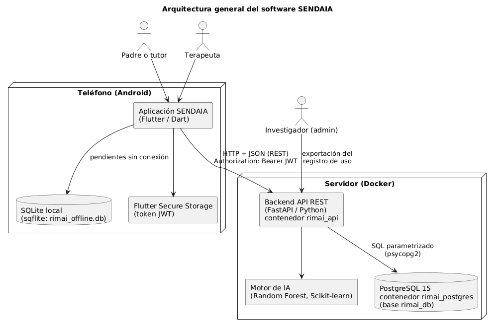
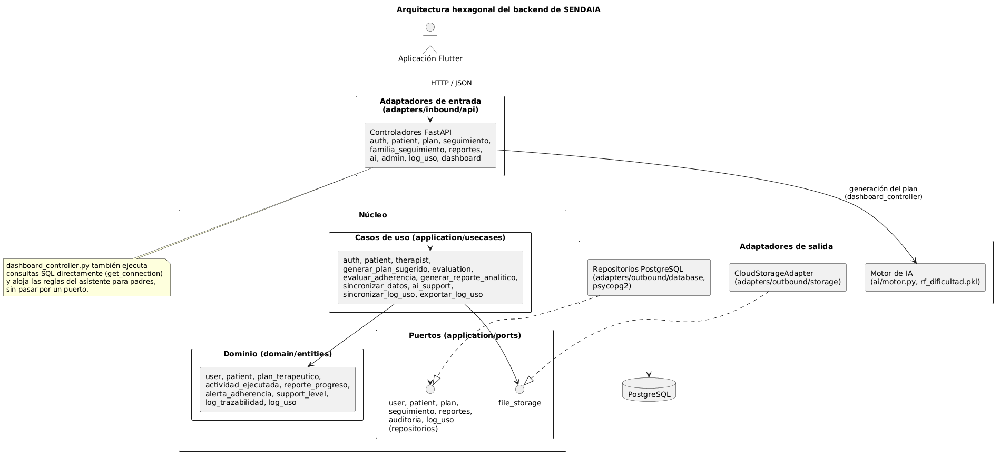
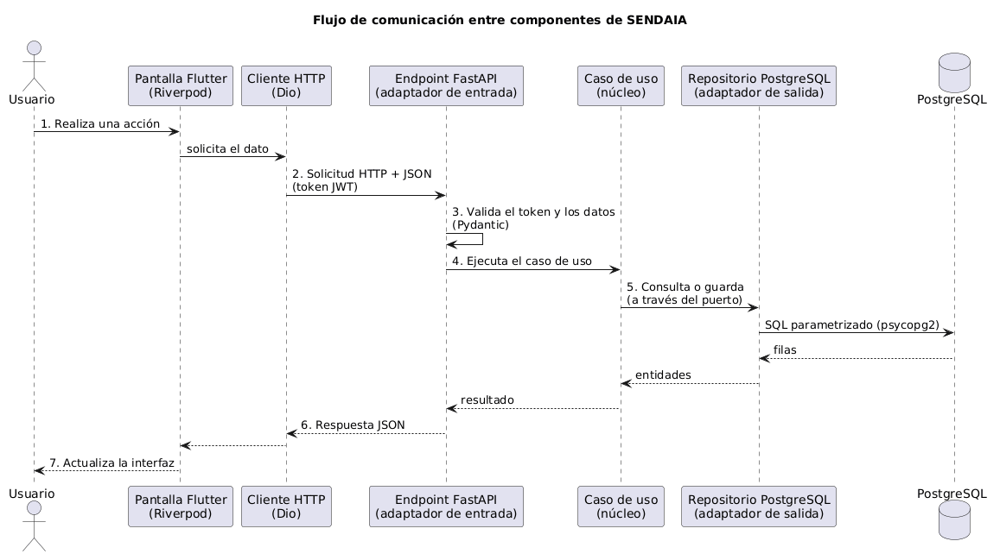
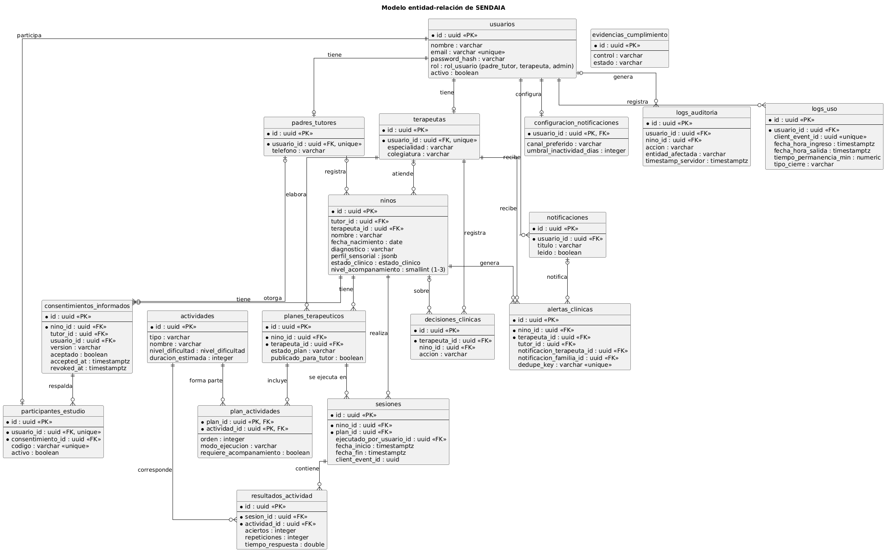
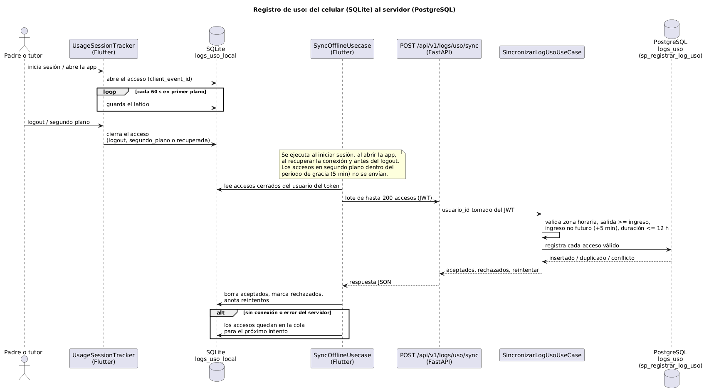

**FACULTAD DE INGENIERÍA**

**Escuela Académico Profesional de Ingeniería de Sistemas e Informática**

**Proyecto de Investigación**

"Implementación de un aplicativo móvil con IA para fortalecer el apoyo parental en el aprendizaje de niños con TDAH del Centro Colibrí, 2026"

**PRESENTADO POR:**

- CARHUAPOMA FANO, Eilene Elizabeth
- HUAMAN BALDEON, Katheryn Elena
- SOSA PORRAS, Jhoan José

**Para optar el Título Profesional de Ingeniero de Sistemas e Informática**

**Huancayo – Perú**
**2026**

---

## ÍNDICE GENERAL

| Sección | Página |
|---|---|
| **PORTADA** | — |
| **ÍNDICE GENERAL** | — |
| **ÍNDICE DE FIGURAS** | — |
| **DOCUMENTACIÓN TÉCNICA DEL SOFTWARE: SENDAIA** | — |
| **1. Descripción general del software** | — |
| **2. Análisis de requisitos** | — |
| 2.1. Usuarios y roles | — |
| 2.2. Descripción de los usuarios | — |
| 2.3. Alcance del sistema | — |
| 2.4. Restricciones del sistema | — |
| 2.5. Relación del análisis de requisitos con los objetivos de la investigación | — |
| **3. Ciclo de vida y metodología de desarrollo** | — |
| 3.1. Ciclo de vida del software | — |
| 3.2. Metodología de desarrollo | — |
| 3.3. Organización de las entregas del software | — |
| 3.4. Actividades de desarrollo y seguimiento | — |
| 3.5. Relación de la metodología con los objetivos de la investigación | — |
| **4. Análisis y definición de requerimientos** | — |
| 4.1. Requerimientos funcionales | — |
| 4.2. Requerimientos no funcionales | — |
| 4.3. Historias de usuario | — |
| 4.4. Criterios de aceptación | — |
| 4.5. Relación de los requerimientos con el proyecto | — |
| **5. Diseño y flujo del sistema** | — |
| 5.1. Diagrama de casos de uso | — |
| 5.2. Diagrama de actividades del registro del niño | — |
| 5.3. Diagrama de actividades de las sugerencias de actividades | — |
| 5.4. Diagrama de actividades del seguimiento familiar | — |
| 5.5. Diagrama de actividades del asistente para padres | — |
| 5.6. Diagrama de secuencia del registro del niño | — |
| 5.7. Diagrama de secuencia de las sugerencias de actividades | — |
| 5.8. Diagrama de secuencia del seguimiento familiar | — |
| 5.9. Diagrama de secuencia del asistente para padres | — |
| **6. Diseño de las interfaces del aplicativo** | — |
| 6.1. Pantalla de inicio de sesión | — |
| 6.2. Pantalla de registro del padre o tutor | — |
| 6.3. Registro del perfil de aprendizaje del niño | — |
| 6.4. Panel principal del padre o tutor | — |
| 6.5. Módulo de perfil de aprendizaje | — |
| 6.6. Módulo de sugerencias de actividades | — |
| 6.7. Espacio de aprendizaje del niño | — |
| 6.8. Módulo de seguimiento familiar | — |
| 6.9. Módulo del asistente para padres | — |
| 6.10. Navegación principal del aplicativo | — |
| **7. Arquitectura y componentes del software SENDAIA** | — |
| 7.1. Arquitectura general del software | — |
| 7.2. Arquitectura del frontend | — |
| 7.2.1. Módulos del frontend | — |
| 7.2.2. Gestión de estados | — |
| 7.2.3. Almacenamiento local y sincronización | — |
| 7.3. Arquitectura del backend (puertos y adaptadores) | — |
| 7.3.1. Procesamiento de solicitudes | — |
| 7.4. Componentes principales del software | — |
| 7.4.1. Módulo de autenticación | — |
| 7.4.2. Módulo de registro y perfil de aprendizaje | — |
| 7.4.3. Módulo de sugerencias de actividades | — |
| 7.4.4. Módulo de espacio de aprendizaje | — |
| 7.4.5. Módulo de seguimiento familiar | — |
| 7.4.6. Asistente para padres | — |
| 7.5. Motor de inteligencia artificial | — |
| 7.5.1. Estimador de dificultad (Random Forest) | — |
| 7.5.2. Motor de sugerencias | — |
| 7.5.3. Alcance y límites | — |
| 7.6. Base de datos | — |
| 7.6.1. Modelo entidad-relación | — |
| 7.6.2. Registro de uso del aplicativo (LogUso) | — |
| 7.7. Comunicación e integración de componentes | — |
| 7.8. Seguridad y protección de datos | — |
| 7.9. Resumen de la arquitectura y componentes | — |
| **8. Pruebas y validación del aplicativo SENDAIA** | — |
| 8.1. Implementación y adaptación del software | — |
| 8.1.1. Implementación del aplicativo | — |
| 8.1.2. Implementación del registro del niño | — |
| 8.1.3. Implementación del perfil de aprendizaje | — |
| 8.1.4. Implementación de las sugerencias de actividades | — |
| 8.1.5. Implementación del espacio de aprendizaje | — |
| 8.1.6. Implementación del seguimiento familiar | — |
| 8.1.7. Implementación del asistente para padres | — |
| 8.1.8. Resultado de la implementación | — |
| 8.2. Pruebas y validación del software | — |
| 8.2.1. Objetivo de las pruebas | — |
| 8.2.2. Tipos de pruebas | — |
| 8.2.3. Diseño de los casos de prueba | — |
| 8.3. Pruebas funcionales por requerimiento | — |
| 8.4. Pruebas de integración | — |
| 8.5. Pruebas de validación | — |
| 8.6. Pruebas de interfaz | — |
| 8.7. Pruebas de seguridad | — |
| 8.8. Evaluación de la usabilidad | — |
| 8.9. Resultados generales de las pruebas | — |
| 8.10. Conclusiones de las pruebas y validación | — |
| 8.11. Migración del enfoque TEA al enfoque TDAH | — |
| 8.12. Registro de uso y aplicación del Instrumento 3 | — |
| 8.13. Instrumentos de recolección de datos de la investigación | — |
| **Referencias** | — |

## ÍNDICE DE FIGURAS

| Figura | Página |
|---|---|
| Figura 1. Diagrama de casos de uso del sistema SENDAIA. | — |
| Figura 2. Diagrama de actividades del proceso de registro del niño en SENDAIA. | — |
| Figura 3. Diagrama de actividades del módulo de sugerencias de actividades. | — |
| Figura 4. Diagrama de actividades del seguimiento familiar. | — |
| Figura 5. Diagrama de actividades del asistente para padres. | — |
| Figura 6. Diagrama de secuencia del registro del niño. | — |
| Figura 7. Diagrama de secuencia de las sugerencias de actividades. | — |
| Figura 8. Diagrama de secuencia del seguimiento familiar. | — |
| Figura 9. Diagrama de secuencia del asistente para padres. | — |
| Figura 10. Interfaz de inicio de sesión del aplicativo SENDAIA. | — |
| Figura 11. Interfaz de registro del padre o tutor. | — |
| Figura 12. Interfaces del proceso de registro del perfil de aprendizaje del niño. | — |
| Figura 13. Interfaz del panel principal del padre o tutor. | — |
| Figura 14. Interfaz del módulo de perfil de aprendizaje. | — |
| Figura 15. Interfaz del módulo de sugerencias de actividades personalizadas. | — |
| Figura 16. Interfaz del espacio de aprendizaje del niño. | — |
| Figura 17. Interfaz del módulo de seguimiento familiar. | — |
| Figura 18. Interfaz del asistente para padres de SENDAIA. | — |
| Figura 19. Interfaz de navegación principal de SENDAIA. | — |
| Figura 20. Arquitectura general del software SENDAIA. | — |
| Figura 21. Arquitectura hexagonal del backend. | — |
| Figura 22. Flujo de comunicación entre componentes. | — |
| Figura 23. Modelo entidad-relación de SENDAIA. | — |
| Figura 24. Flujo sin conexión del registro de uso (SQLite → PostgreSQL). | — |

---

# DOCUMENTACIÓN TÉCNICA DEL SOFTWARE: SENDAIA

Link del GitHub: https://github.com/Enelie/SendaIA.git

## 1. Descripción general del software

El software desarrollado corresponde a SENDAIA, una aplicación móvil basada en inteligencia artificial, orientada a padres, madres y tutores de niños con Trastorno por Déficit de Atención e Hiperactividad (TDAH). Su finalidad es proporcionar herramientas de apoyo parental que faciliten el acompañamiento del aprendizaje de los niños en el entorno familiar, mediante el registro de sus características individuales, la recomendación de actividades educativas personalizadas y la orientación sobre estrategias que favorezcan su proceso de aprendizaje.

SENDAIA está desarrollado con Flutter y Dart para la aplicación móvil, mientras que su backend utiliza FastAPI y Python para gestionar las operaciones del sistema, la comunicación entre sus componentes y los procesos de personalización. Asimismo, emplea PostgreSQL como sistema de gestión de base de datos para almacenar la información de los usuarios, los perfiles de aprendizaje de los niños, el catálogo de actividades y los registros relacionados con su realización.

El aplicativo tiene como usuario principal al padre, madre o tutor, quien puede acceder a un panel familiar que integra cinco secciones principales:

- **Inicio:** constituye el espacio principal de navegación, donde se presenta el resumen del perfil del niño y los accesos a las funcionalidades del aplicativo.
- **Perfil de aprendizaje:** permite registrar, consultar y actualizar información del niño, considerando sus características de aprendizaje, nivel de atención, seguimiento de instrucciones, intereses, distractores, preferencias y condiciones del entorno de estudio.
- **Sugerencias de actividades:** presenta recomendaciones educativas personalizadas a partir de la información registrada en el perfil del niño. Estas actividades se organizan en cinco áreas principales: comprensión lectora, expresión escrita, razonamiento lógico, análisis y autonomía. Además, incorpora actividades complementarias relacionadas con pausas activas. Las recomendaciones incluyen información sobre su propósito, dificultad, duración y orientaciones para que el padre o tutor pueda acompañar su realización.
- **Seguimiento familiar:** permite consultar el historial de actividades realizadas, los registros de acompañamiento en casa y los indicadores de progreso disponibles, facilitando el seguimiento de las acciones educativas desarrolladas por la familia.
- **Asistente para padres:** proporciona orientación sobre el acompañamiento del aprendizaje mediante respuestas contextualizadas en tres ejes: orientación académica, comunicación y motivación, y organización del entorno y pausas. Su funcionamiento se basa en reglas locales y contextuales que utilizan información del perfil del niño y los temas de consulta del usuario.

En cuanto a la personalización, SENDAIA incorpora un mecanismo de selección de actividades que considera las características registradas en el perfil de aprendizaje del niño. Asimismo, utiliza un estimador pedagógico de dificultad basado en variables relacionadas con la edad, el nivel de atención, el seguimiento de instrucciones y la fatiga. Este mecanismo permite orientar la selección de actividades de acuerdo con las características individuales registradas.

El aplicativo contempla dos modalidades de realización de actividades: la ejecución de ejercicios mediante las funcionalidades disponibles dentro de la aplicación y la realización de actividades en el entorno familiar, cuyo cumplimiento puede ser registrado por el padre o tutor. De esta manera, se busca facilitar la participación de la familia en el acompañamiento educativo y disponer de información para el seguimiento de las actividades desarrolladas.

El alcance de SENDAIA comprende el registro y la gestión del perfil de aprendizaje del niño, la generación de sugerencias educativas personalizadas, el acceso a actividades de aprendizaje, el registro y consulta de actividades realizadas y la orientación proporcionada por el asistente para padres. El sistema no tiene como finalidad diagnosticar el TDAH, prescribir tratamientos ni sustituir la atención de profesionales especializados. Su propósito se centra en brindar recursos tecnológicos que faciliten el acompañamiento parental en el aprendizaje de los niños.

En relación con la investigación, SENDAIA constituye la variable independiente, correspondiente al aplicativo basado en inteligencia artificial, cuyas dimensiones se relacionan con la usabilidad, funcionalidad, interacción y personalización. Asimismo, sus funcionalidades están orientadas a contribuir al apoyo parental en el aprendizaje, variable dependiente que comprende las dimensiones de acompañamiento académico, comunicación y motivación, y organización del entorno de aprendizaje.

## CAPÍTULO 2. ANÁLISIS DE REQUISITOS

### 2.1. Usuarios y roles

SENDAIA está dirigido principalmente a padres, madres y tutores de niños con Trastorno por Déficit de Atención e Hiperactividad (TDAH), quienes utilizan el aplicativo para registrar información de sus hijos, consultar recomendaciones educativas y acompañar la realización de actividades de aprendizaje en el entorno familiar.

El sistema contempla al siguiente usuario principal:

| Usuario | Descripción | Funciones dentro del sistema |
|---|---|---|
| Padre, madre o tutor | Persona responsable del niño que utiliza SENDAIA como herramienta de apoyo al aprendizaje. | Registrarse e iniciar sesión, registrar y actualizar el perfil de aprendizaje del niño, consultar sugerencias de actividades, acompañar su ejecución, registrar actividades realizadas, consultar el seguimiento familiar e interactuar con el asistente de IA. |

Asimismo, el niño constituye el beneficiario directo del aplicativo, ya que las actividades y estrategias propuestas están orientadas a apoyar su aprendizaje. Su participación puede realizarse mediante ejercicios dentro de la aplicación o actividades desarrolladas en casa con el acompañamiento del padre o tutor.

El motor de inteligencia artificial forma parte de los componentes internos del sistema y se encarga de procesar la información del perfil de aprendizaje para generar sugerencias educativas y proporcionar orientación contextualizada.

### 2.2. Descripción de los usuarios

El usuario principal de SENDAIA corresponde a padres, madres o tutores que requieren herramientas para acompañar el aprendizaje de sus hijos con TDAH.

Se considera que los usuarios pueden tener diferentes niveles de familiaridad con aplicaciones móviles, por lo que el sistema presenta una interfaz intuitiva, una navegación organizada y opciones claramente identificadas.

Las principales necesidades del usuario son:

- Registrar y mantener actualizada la información relacionada con el aprendizaje del niño.
- Identificar actividades educativas acordes con sus características e intereses.
- Obtener orientaciones para acompañar las actividades en casa.
- Consultar las actividades realizadas y revisar su historial.
- Recibir estrategias para favorecer la motivación, la comunicación y la organización del entorno de aprendizaje.

### 2.3. Alcance del sistema

El alcance funcional de SENDAIA comprende las herramientas necesarias para facilitar el acompañamiento parental en el aprendizaje de niños con TDAH.

El aplicativo contempla las siguientes funcionalidades:

| Módulo | Descripción |
|---|---|
| Inicio | Presenta el resumen del perfil del niño y permite acceder a las principales funcionalidades. |
| Perfil de aprendizaje | Permite registrar, consultar y actualizar las características, intereses, dificultades y preferencias de aprendizaje del niño. |
| Sugerencias de actividades | Genera recomendaciones educativas personalizadas organizadas en cinco áreas: comprensión lectora, expresión escrita, razonamiento lógico, análisis y autonomía. Incluye actividades complementarias de pausas activas. |
| Espacio de aprendizaje | Permite realizar actividades educativas mediante la aplicación y registrar su desarrollo. |
| Seguimiento familiar | Permite consultar el historial de actividades realizadas, registros de acompañamiento e indicadores disponibles. |
| Asistente para padres | Brinda orientación contextualizada sobre acompañamiento académico, comunicación y motivación, y organización del entorno y pausas. |

### 2.4. Restricciones del sistema

SENDAIA considera las siguientes restricciones para su utilización:

1. El acceso a las funcionalidades del aplicativo requiere que el padre o tutor cuente con una cuenta registrada.
2. La información del perfil de aprendizaje depende de los datos proporcionados por el padre o tutor.
3. Las sugerencias de actividades se generan a partir de la información disponible en el perfil del niño y del catálogo educativo del sistema.
4. El estimador pedagógico proporciona una referencia para orientar la dificultad de las actividades, no constituye una evaluación psicopedagógica.
5. Las recomendaciones del sistema tienen carácter orientativo y no sustituyen la evaluación ni la atención de profesionales especializados.
6. El registro de las actividades realizadas en casa depende de la información proporcionada por el padre o tutor.

### 2.5. Relación del análisis de requisitos con los objetivos de la investigación

Los requisitos establecidos para SENDAIA mantienen correspondencia con el propósito de la investigación, debido a que sus funcionalidades están orientadas a proporcionar herramientas tecnológicas que faciliten el acompañamiento parental en el aprendizaje de niños con TDAH.

La relación con las variables de investigación se presenta en la siguiente tabla:

| Variable | Dimensión | Funcionalidades relacionadas |
|---|---|---|
| Independiente: Aplicativo móvil basado en IA | Usabilidad | Navegación intuitiva, organización de módulos y facilidad de acceso. |
| | Funcionalidad | Registro del perfil, sugerencias, actividades y seguimiento familiar. |
| | Interacción y personalización | Comunicación con el asistente para padres y utilización de las actividades. Selección de actividades y estimación pedagógica de dificultad según el perfil del niño. |
| Dependiente: Apoyo parental en el aprendizaje | Acompañamiento académico | Actividades educativas y orientaciones para acompañar su realización. |
| | Comunicación y motivación | Estrategias y recomendaciones para motivar al niño durante el aprendizaje. |
| | Organización del entorno de aprendizaje | Orientaciones sobre rutinas, distractores, pausas y condiciones del espacio de estudio. |

De esta manera, los requisitos permiten establecer las funcionalidades que debe ofrecer SENDAIA y constituyen la base para el diseño de sus interfaces, procesos internos y componentes tecnológicos.

## CAPÍTULO 3. CICLO DE VIDA Y METODOLOGÍA DE DESARROLLO

### 3.1. Ciclo de vida del software

El desarrollo de SENDAIA se organiza mediante un ciclo de vida compuesto por las etapas de análisis de requisitos, diseño, desarrollo, pruebas, implementación y mantenimiento. Estas etapas permiten estructurar el proceso de construcción del aplicativo, desde la identificación de las necesidades de los usuarios hasta la verificación de sus funcionalidades.

El ciclo de vida contempla un enfoque iterativo e incremental, mediante el cual el software se desarrolla progresivamente, incorporando funcionalidades en diferentes entregas y realizando ajustes conforme se identifican necesidades de mejora.

Las etapas consideradas son las siguientes:

| Etapa | Descripción | Actividades realizadas en SENDAIA |
|---|---|---|
| Análisis de requisitos | Identificación de las necesidades del usuario y las funcionalidades del aplicativo. | Definición de los requerimientos relacionados con el registro del niño, perfil de aprendizaje, sugerencias educativas, seguimiento y asistente para padres. |
| Diseño | Organización de la estructura funcional y visual del sistema. | Diseño del panel familiar, formularios de registro, módulos de aprendizaje y navegación de la aplicación. |
| Desarrollo | Implementación de las funcionalidades y componentes del software. | Programación de los módulos de SENDAIA, servicios backend, persistencia de información y mecanismos de personalización. |
| Pruebas | Verificación del funcionamiento de los componentes implementados. | Comprobación del registro, autenticación, consulta del perfil, generación de sugerencias y funcionamiento de las actividades. |
| Implementación | Preparación del aplicativo para su utilización. | Integración de los componentes móviles y backend para permitir el funcionamiento del sistema. |
| Mantenimiento | Corrección de errores y realización de mejoras. | Ajustes de interfaz, optimización de funcionalidades y corrección de problemas identificados durante las pruebas. |

### 3.2. Metodología de desarrollo

Para el desarrollo de SENDAIA se considera un enfoque ágil basado en Scrum, complementado con un desarrollo iterativo e incremental. Esta metodología permite organizar el trabajo en periodos cortos, establecer prioridades y desarrollar las funcionalidades del aplicativo progresivamente.

La elección de este enfoque responde a la necesidad de construir un sistema que incorpora diferentes módulos relacionados entre sí, como el perfil de aprendizaje, las sugerencias personalizadas, las actividades educativas, el seguimiento familiar y el asistente para padres.

Se consideran las siguientes características metodológicas:

| Metodología | Características | Decisión para SENDAIA |
|---|---|---|
| Cascada | Organiza el desarrollo en fases secuenciales, donde cada etapa debe finalizar antes de iniciar la siguiente. | No se adopta como enfoque principal, debido a que el proyecto requiere ajustes progresivos. |
| Iterativa | Permite revisar y mejorar continuamente las funcionalidades desarrolladas. | Se aplica para realizar ajustes y optimizaciones en los módulos del aplicativo. |
| Incremental | Divide el desarrollo en entregas que incorporan nuevas funcionalidades al sistema. | Se adopta para construir SENDAIA progresivamente mediante diferentes entregas. |
| Scrum | Organiza el trabajo en iteraciones cortas, con planificación, desarrollo y revisión de resultados. | Se considera como marco de organización del trabajo, complementado con un tablero Scrum-Kanban para gestionar las tareas. |

Decisión metodológica: SENDAIA se desarrolla mediante un enfoque ágil e incremental, utilizando iteraciones cortas que permiten organizar las actividades, implementar funcionalidades y verificar progresivamente los resultados obtenidos.

### 3.3. Organización de las entregas del software

El desarrollo de SENDAIA se organiza en tres entregas incrementales, correspondientes a la construcción de la base del aplicativo, la incorporación de funcionalidades de personalización y el fortalecimiento del seguimiento del aprendizaje.

Las entregas se describen a continuación:

| Entrega | Objetivo | Funcionalidades principales | Dimensiones relacionadas |
|---|---|---|---|
| PMV 1: Estructura y registro del aplicativo | Establecer la estructura principal de SENDAIA y permitir el registro de información del niño. | Registro e inicio de sesión del padre o tutor, registro del niño, perfil de aprendizaje y panel familiar. | Usabilidad y funcionalidad. |
| PMV 2: Personalización y apoyo al aprendizaje | Incorporar mecanismos que permitan orientar el acompañamiento educativo según las características del niño. | Catálogo de actividades educativas, sugerencias personalizadas, estimador pedagógico de dificultad y asistente para padres. | Funcionalidad, interacción, personalización, acompañamiento académico y comunicación y motivación. |
| PMV 3: Seguimiento y organización del aprendizaje | Fortalecer el registro y consulta de las actividades realizadas en el entorno familiar. | Ejecución de actividades, registro de actividades realizadas en casa, historial, indicadores de seguimiento y orientaciones sobre organización del entorno y pausas. | Usabilidad, funcionalidad, acompañamiento académico y organización del entorno de aprendizaje. |

Las entregas permiten establecer una secuencia de desarrollo en la que cada incremento incorpora funcionalidades que complementan las anteriores. De esta manera, el aplicativo evoluciona desde una estructura básica de registro hasta una solución que integra personalización, actividades educativas y herramientas de seguimiento para los padres o tutores.

### 3.4. Actividades de desarrollo y seguimiento

Para organizar el proceso de desarrollo se consideran actividades de planificación, implementación, revisión y mejora continua.

| Actividad | Descripción |
|---|---|
| Planificación | Identificación de las funcionalidades que deben desarrollarse y establecimiento de prioridades. |
| Organización de tareas | Distribución de las actividades de desarrollo mediante un tablero de seguimiento. |
| Implementación | Desarrollo de los componentes móviles, servicios backend y funcionalidades del sistema. |
| Revisión | Comprobación de las funcionalidades incorporadas en cada incremento. |
| Corrección | Identificación y solución de errores detectados durante las pruebas. |
| Mejora continua | Incorporación de ajustes para mejorar la usabilidad, funcionalidad y personalización del aplicativo. |

El seguimiento de estas actividades permite mantener una organización progresiva del desarrollo y verificar que las funcionalidades implementadas respondan a los requerimientos establecidos para SENDAIA.

### 3.5. Relación de la metodología con los objetivos de la investigación

La metodología de desarrollo utilizada contribuye a la construcción progresiva de SENDAIA, permitiendo implementar funcionalidades relacionadas con las dimensiones de la variable independiente y las dimensiones de la variable dependiente de la investigación.

| Variable | Dimensión | Aporte del proceso de desarrollo |
|---|---|---|
| Aplicativo móvil basado en IA | Usabilidad | Desarrollo de interfaces organizadas y navegación sencilla. |
| | Funcionalidad | Implementación progresiva de los módulos del aplicativo. |
| | Interacción y personalización | Incorporación del asistente para padres y actividades educativas. Desarrollo del mecanismo de selección de actividades según el perfil del niño. |
| Apoyo parental en el aprendizaje | Acompañamiento académico | Incorporación de actividades educativas y herramientas para realizarlas en casa. |
| | Comunicación y motivación | Desarrollo de orientaciones para favorecer la participación y motivación del niño. |
| | Organización del entorno de aprendizaje | Incorporación de recomendaciones sobre rutinas, distractores y pausas. |

En consecuencia, el enfoque iterativo e incremental permite desarrollar y mejorar las funcionalidades de SENDAIA de manera progresiva, manteniendo su correspondencia con los objetivos de la investigación.

## CAPÍTULO 4. ANÁLISIS Y DEFINICIÓN DE REQUERIMIENTOS

### 4.1. Requerimientos funcionales

Los requerimientos funcionales describen las operaciones y servicios que SENDAIA debe proporcionar al padre o tutor. Estos se establecen considerando las funcionalidades implementadas en los módulos de inicio, perfil de aprendizaje, sugerencias de actividades, seguimiento familiar y asistente para padres.

| Código | Requerimiento funcional |
|---|---|
| RF01 | El sistema debe permitir al padre o tutor registrarse e iniciar sesión en el aplicativo. |
| RF02 | El sistema debe permitir acceder al panel familiar después de una autenticación válida. |
| RF03 | El sistema debe permitir registrar uno o varios niños asociados a la cuenta del padre o tutor. |
| RF04 | El sistema debe permitir registrar los datos básicos del niño, como nombre y fecha de nacimiento. |
| RF05 | El sistema debe permitir registrar opcionalmente información sobre un diagnóstico previo de TDAH. |
| RF06 | El sistema debe permitir registrar información sobre las características de aprendizaje del niño. |
| RF07 | El sistema debe permitir registrar el nivel de atención, seguimiento de instrucciones, forma de aprendizaje y dificultades durante las actividades académicas. |
| RF08 | El sistema debe permitir registrar información sobre el entorno de aprendizaje del niño. |
| RF09 | El sistema debe permitir identificar distractores y factores que dificultan la concentración. |
| RF10 | El sistema debe permitir registrar el lugar habitual de estudio, las rutinas y la necesidad de realizar pausas. |
| RF11 | El sistema debe permitir registrar los intereses y actividades que motivan al niño. |
| RF12 | El sistema debe permitir consultar y actualizar el perfil de aprendizaje registrado. |
| RF13 | El sistema debe generar sugerencias de actividades educativas personalizadas considerando la información del perfil del niño. |
| RF14 | El sistema debe organizar las actividades recomendadas en las áreas de comprensión lectora, expresión escrita, razonamiento lógico, análisis y autonomía. |
| RF15 | El sistema debe incorporar actividades complementarias relacionadas con pausas activas. |
| RF16 | El sistema debe presentar información de las actividades sugeridas, incluyendo su propósito, dificultad, duración, materiales y orientaciones para realizarlas en casa, según la información disponible. |
| RF17 | El sistema debe permitir filtrar las sugerencias según el área de aprendizaje. |
| RF18 | El sistema debe permitir acceder a las actividades para realizarlas mediante las funcionalidades disponibles en la aplicación. |
| RF19 | El sistema debe permitir registrar la realización de actividades desarrolladas fuera de la aplicación, con el acompañamiento del padre o tutor. |
| RF20 | El sistema debe permitir registrar los resultados y la información correspondiente a las actividades realizadas. |
| RF21 | El sistema debe proporcionar un módulo de seguimiento familiar para consultar el historial de actividades. |
| RF22 | El sistema debe presentar indicadores y representaciones gráficas del seguimiento cuando existan registros disponibles. |
| RF23 | El sistema debe permitir consultar el progreso de las actividades mediante filtros por periodos de tiempo. |
| RF24 | El sistema debe proporcionar un asistente para padres que permita realizar consultas relacionadas con el aprendizaje del niño. |
| RF25 | El asistente debe brindar orientación sobre acompañamiento académico, comunicación y motivación, y organización del entorno y pausas. |
| RF26 | El asistente debe utilizar información contextual del perfil del niño para proporcionar respuestas relacionadas con sus características y necesidades de aprendizaje. |
| RF27 | El sistema debe proporcionar una estimación pedagógica de dificultad considerando variables como edad, nivel de atención, seguimiento de instrucciones y fatiga. |

### 4.2. Requerimientos no funcionales

Los requerimientos no funcionales establecen las características de calidad, seguridad y condiciones generales que debe cumplir SENDAIA para ofrecer una experiencia adecuada al usuario.

| Código | Requerimiento no funcional |
|---|---|
| RNF01 | La interfaz debe presentar una navegación sencilla e intuitiva para el padre o tutor. |
| RNF02 | El aplicativo debe organizar el registro del niño de manera progresiva mediante cuatro etapas. |
| RNF03 | El sistema debe validar la información requerida antes de permitir continuar con el registro. |
| RNF04 | La información de cada niño debe mantenerse asociada a la cuenta del padre o tutor correspondiente. |
| RNF05 | El sistema debe presentar la información del perfil de aprendizaje de manera organizada y comprensible. |
| RNF06 | La interfaz debe mantener una distribución visual coherente entre los diferentes módulos del aplicativo. |
| RNF07 | El aplicativo debe presentar mensajes comprensibles para informar sobre las acciones realizadas, errores y estados de carga. |
| RNF08 | El sistema debe controlar el acceso a la información para evitar que un usuario consulte datos de niños pertenecientes a otras familias. |
| RNF09 | El aplicativo debe contar con una interfaz adaptable a diferentes tamaños de pantalla de dispositivos móviles. |
| RNF10 | Las sugerencias de actividades deben presentar información comprensible sobre los motivos de su selección. |
| RNF11 | El asistente debe proporcionar respuestas relacionadas con los temas contemplados en su funcionamiento y utilizar el contexto disponible del niño. |
| RNF12 | El sistema debe proteger la información personal y educativa registrada por los usuarios. |
| RNF13 | El aplicativo debe mantener la consistencia de la información registrada durante las operaciones de consulta y actualización. |
| RNF14 | Las recomendaciones y respuestas del asistente deben presentarse como orientaciones educativas y no como diagnósticos o indicaciones clínicas. |

### 4.3. Historias de usuario

Las historias de usuario permiten describir las funcionalidades de SENDAIA desde la perspectiva del padre o tutor, considerando las necesidades que busca satisfacer mediante el aplicativo.

| Código | Historia de usuario |
|---|---|
| HU01 | Como padre o tutor, quiero registrarme e iniciar sesión para acceder de manera segura al aplicativo. |
| HU02 | Como padre o tutor, quiero registrar a mi hijo para disponer de un perfil de aprendizaje dentro del sistema. |
| HU03 | Como padre o tutor, quiero registrar las características de aprendizaje de mi hijo para identificar sus necesidades educativas. |
| HU04 | Como padre o tutor, quiero registrar los distractores y condiciones de su entorno para conocer qué factores pueden dificultar su concentración. |
| HU05 | Como padre o tutor, quiero registrar los intereses de mi hijo para que las actividades recomendadas consideren aquello que le motiva. |
| HU06 | Como padre o tutor, quiero consultar y actualizar el perfil de aprendizaje para mantener su información vigente. |
| HU07 | Como padre o tutor, quiero recibir sugerencias personalizadas para identificar actividades que pueda realizar con mi hijo. |
| HU08 | Como padre o tutor, quiero filtrar las actividades por áreas de aprendizaje para encontrar ejercicios relacionados con las habilidades que deseo trabajar. |
| HU09 | Como padre o tutor, quiero conocer los motivos y orientaciones de cada sugerencia para comprender cómo acompañar su realización. |
| HU10 | Como padre o tutor, quiero realizar actividades educativas dentro de la aplicación para acompañar el aprendizaje de mi hijo. |
| HU11 | Como padre o tutor, quiero registrar las actividades realizadas en casa para mantener un historial de su acompañamiento. |
| HU12 | Como padre o tutor, quiero consultar el seguimiento familiar para conocer las actividades realizadas y los indicadores disponibles. |
| HU13 | Como padre o tutor, quiero consultar gráficas y filtrar los resultados por periodos para revisar los registros de aprendizaje. |
| HU14 | Como padre o tutor, quiero interactuar con el asistente para recibir orientación sobre cómo acompañar el aprendizaje de mi hijo. |
| HU15 | Como padre o tutor, quiero recibir estrategias relacionadas con la motivación, comunicación y organización del entorno para favorecer las actividades de aprendizaje. |

### 4.4. Criterios de aceptación

Los criterios de aceptación permiten establecer las condiciones que deben cumplirse para considerar que las principales funcionalidades del aplicativo responden a los requerimientos establecidos.

| Código | Criterio de aceptación |
|---|---|
| CA01 | El usuario puede registrarse e iniciar sesión proporcionando información válida. |
| CA02 | El usuario puede acceder al panel familiar después de iniciar sesión correctamente. |
| CA03 | El sistema permite registrar los datos básicos del niño y continuar con las siguientes etapas del formulario. |
| CA04 | El sistema permite completar las cuatro etapas del registro del perfil de aprendizaje. |
| CA05 | El sistema guarda y presenta la información registrada del niño de manera organizada. |
| CA06 | El usuario puede consultar y editar el perfil de aprendizaje de su hijo. |
| CA07 | El sistema genera sugerencias de actividades considerando la información disponible en el perfil del niño. |
| CA08 | Las sugerencias se presentan organizadas por las cinco áreas principales de aprendizaje e incluyen actividades complementarias de pausas activas. |
| CA09 | El usuario puede consultar los motivos, dificultad, duración y orientaciones de las actividades sugeridas, según los datos disponibles. |
| CA10 | El usuario puede filtrar las actividades recomendadas por área de aprendizaje. |
| CA11 | El usuario puede acceder a las actividades disponibles para realizarlas mediante la aplicación. |
| CA12 | El usuario puede registrar actividades realizadas fuera de la aplicación con su respectiva información. |
| CA13 | El sistema permite consultar el historial de actividades realizadas. |
| CA14 | El sistema presenta indicadores y gráficas de seguimiento cuando existen registros suficientes. |
| CA15 | El usuario puede consultar el seguimiento familiar mediante filtros por periodos de tiempo. |
| CA16 | El usuario puede acceder al asistente para padres desde el panel familiar. |
| CA17 | El asistente proporciona orientación relacionada con los tres ejes establecidos: acompañamiento académico, comunicación y motivación, y organización del entorno y pausas. |
| CA18 | Las respuestas del asistente consideran la información contextual disponible del perfil del niño. |
| CA19 | El sistema presenta una estimación pedagógica de dificultad considerando las variables educativas registradas. |
| CA20 | El sistema restringe el acceso a los perfiles de niños para que cada familia consulte únicamente su propia información. |

### 4.5. Relación de los requerimientos con el proyecto

Los requerimientos funcionales y no funcionales establecidos para SENDAIA mantienen correspondencia con los objetivos de la investigación, debido a que las funcionalidades del aplicativo están orientadas a facilitar el apoyo parental en el aprendizaje de niños con TDAH.

La siguiente tabla presenta la relación entre los requerimientos del sistema y las variables de investigación.

| Variable | Dimensión | Requerimientos relacionados | Contribución |
|---|---|---|---|
| Independiente: Aplicativo móvil basado en IA | Usabilidad | RF01, RF02, RF03, RF12, RNF01, RNF02, RNF05, RNF06 y RNF09. | Facilita el acceso, la navegación y la utilización de las funcionalidades del aplicativo. |
| | Funcionalidad | RF04 al RF27, según la funcionalidad correspondiente. | Permite desarrollar las operaciones de registro, personalización, ejecución y seguimiento. |
| | Interacción y personalización | RF18 al RF26, HU10 al HU15. RF13, RF16, RF17, RF27 y RNF10. | Facilita la interacción del padre o tutor con las actividades educativas y el asistente. Permite generar sugerencias considerando las características e intereses del niño. |
| Dependiente: Apoyo parental en el aprendizaje | Acompañamiento académico | RF13 al RF20 y HU07 al HU12. | Proporciona actividades y orientaciones para que el padre o tutor acompañe el aprendizaje. |
| | Comunicación y motivación | RF24, RF25, RF26 y HU14, HU15. | Brinda estrategias de orientación para favorecer la comunicación y motivación durante el aprendizaje. |
| | Organización del entorno de aprendizaje | RF08, RF09, RF10, RF15, RF25 y HU04, HU15. | Facilita la identificación de distractores, la organización de rutinas y la incorporación de pausas. |

En conjunto, los requerimientos permiten establecer una estructura funcional orientada al propósito de SENDAIA. La integración del perfil de aprendizaje, las sugerencias personalizadas, las actividades educativas, el seguimiento familiar y el asistente para padres proporciona herramientas que buscan facilitar la participación de la familia en el proceso de aprendizaje del niño.

Asimismo, estos requerimientos constituyen la base para el diseño de los procesos, las interfaces y la arquitectura del aplicativo, permitiendo mantener la correspondencia entre las funcionalidades del software y las dimensiones consideradas en la investigación.

## CAPÍTULO 5. DISEÑO Y FLUJO DEL SISTEMA

### 5.1. Diagrama de casos de uso

Descripción:

El diagrama de casos de uso representa las funcionalidades principales de SENDAIA y la interacción del padre o tutor con el aplicativo.

El usuario puede registrarse e iniciar sesión, gestionar el perfil de aprendizaje de uno o varios niños, consultar sugerencias personalizadas, acceder a las actividades educativas, registrar su realización, consultar el seguimiento familiar e interactuar con el asistente para padres.

El motor de personalización y el asistente contextual se representan como componentes internos del sistema, no como usuarios externos.

> [Imagen del diagrama en el documento original]

Figura 1. Diagrama de casos de uso del sistema SENDAIA. Fuente: Elaboración propia.

### 5.2. Diagrama de actividades del registro del niño

Descripción:

Este diagrama representa el proceso mediante el cual el padre o tutor registra la información del niño. El procedimiento se encuentra organizado en cuatro etapas:

1. Datos básicos.
2. Perfil de aprendizaje.
3. Entorno y aprendizaje.
4. Intereses y resumen.

El proceso contempla la validación de los datos ingresados y permite regresar a una etapa anterior cuando se requiere corregir información. Finalmente, el sistema consolida los datos y registra el perfil de aprendizaje.

> [Imagen del diagrama en el documento original]

Figura 2. Diagrama de actividades del proceso de registro del niño en SENDAIA. Fuente: Elaboración propia.

### 5.3. Diagrama de actividades de las sugerencias de actividades

Descripción:

Este diagrama representa el funcionamiento del módulo de sugerencias de actividades. El proceso comienza cuando el padre o tutor selecciona al niño y accede a las recomendaciones educativas.

El sistema recupera la información del perfil de aprendizaje y utiliza el mecanismo de personalización para evaluar las características registradas. Posteriormente, selecciona actividades del catálogo educativo y presenta las sugerencias correspondientes.

La selección considera las cinco áreas principales: comprensión lectora, expresión escrita, razonamiento lógico, análisis y autonomía. También contempla actividades complementarias de pausas activas.

> [Imagen del diagrama en el documento original]

Figura 3. Diagrama de actividades del módulo de sugerencias de actividades. Fuente: Elaboración propia.

### 5.4. Diagrama de actividades del seguimiento familiar

Descripción:

El diagrama representa el proceso mediante el cual el padre o tutor consulta las actividades realizadas por el niño y revisa la información disponible sobre su progreso.

El sistema recupera los registros almacenados, organiza el historial cronológicamente y presenta indicadores y gráficas según el periodo seleccionado. Cuando existen actividades pendientes de sincronización, el aplicativo puede informar esta condición al usuario.

> [Imagen del diagrama en el documento original]

Figura 4. Diagrama de actividades del seguimiento familiar. Fuente: Elaboración propia.

### 5.5. Diagrama de actividades del asistente para padres

Descripción:

Este diagrama representa el proceso de interacción entre el padre o tutor y el asistente para padres. El usuario ingresa una consulta relacionada con el aprendizaje de su hijo y el sistema identifica el tema correspondiente.

El asistente utiliza reglas locales y contextuales, considerando la información disponible del perfil del niño, para generar una respuesta orientativa. Las consultas se organizan en tres ejes: orientación académica, comunicación y motivación, y organización del entorno y pausas.

> [Imagen del diagrama en el documento original]

Figura 5. Diagrama de actividades del asistente para padres. Fuente: Elaboración propia.

### 5.6. Diagrama de secuencia del registro del niño

Descripción:

El diagrama de secuencia representa la comunicación entre el padre o tutor, la interfaz móvil, el backend y la base de datos durante el registro del niño.

El usuario completa las cuatro etapas del formulario. La aplicación envía la información al backend, donde se realizan las validaciones correspondientes y se almacena el perfil en la base de datos. Finalmente, el sistema devuelve una respuesta que permite informar al usuario sobre el resultado del registro.

> [Imagen del diagrama en el documento original]

Figura 6. Diagrama de secuencia del registro del niño. Fuente: Elaboración propia.

### 5.7. Diagrama de secuencia de las sugerencias de actividades

Descripción:

Este diagrama representa la interacción entre el usuario y los componentes internos encargados de generar las sugerencias educativas.

La aplicación solicita las recomendaciones correspondientes al niño seleccionado. El backend recupera su perfil, procesa las características educativas mediante el mecanismo de personalización y consulta el catálogo de actividades. Finalmente, devuelve las sugerencias para que sean presentadas en la aplicación móvil.

> [Imagen del diagrama en el documento original]

Figura 7. Diagrama de secuencia de las sugerencias de actividades. Fuente: Elaboración propia.

### 5.8. Diagrama de secuencia del seguimiento familiar

Descripción:

El diagrama representa la interacción entre el padre o tutor y los componentes del sistema cuando consulta el seguimiento familiar.

La aplicación solicita los registros de actividades del niño. El backend verifica los permisos del usuario, recupera la información almacenada y procesa los indicadores disponibles. Finalmente, devuelve los resultados para que la aplicación presente el historial y las gráficas correspondientes.

> [Imagen del diagrama en el documento original]

Figura 8. Diagrama de secuencia del seguimiento familiar. Fuente: Elaboración propia.

### 5.9. Diagrama de secuencia del asistente para padres

Descripción:

Este diagrama representa la comunicación entre el padre o tutor, la aplicación móvil y el componente encargado del funcionamiento del asistente.

Cuando el usuario envía una consulta, la aplicación procesa la interacción y obtiene el contexto disponible del perfil del niño. Posteriormente, el mecanismo de reglas locales identifica el tema de la consulta y construye una respuesta orientativa que se presenta al usuario.

> [Imagen del diagrama en el documento original]

Figura 9. Diagrama de secuencia del asistente para padres. Fuente: Elaboración propia.

## CAPÍTULO 6. DISEÑO DE LAS INTERFACES DEL APLICATIVO

El presente capítulo describe las principales interfaces de usuario del aplicativo móvil SENDAIA, desarrollado con Flutter. Se presentan las pantallas que permiten al padre, madre o tutor gestionar el perfil de aprendizaje del niño, consultar sugerencias de actividades personalizadas, realizar actividades educativas, revisar el seguimiento familiar e interactuar con el asistente de inteligencia artificial.

Las interfaces han sido organizadas considerando la facilidad de uso, la navegación intuitiva y la presentación clara de la información, con el propósito de facilitar el acompañamiento parental en el aprendizaje de niños con TDAH.

### 6.1. Pantalla de inicio de sesión

Esta pantalla permite que los padres, madres o tutores accedan al aplicativo mediante sus credenciales. El usuario debe ingresar su correo electrónico y contraseña previamente registrados.

La interfaz contempla las opciones necesarias para iniciar sesión y acceder al panel familiar, manteniendo el acceso restringido a usuarios autenticados.

*[Captura pendiente: pantalla de inicio de sesión de SENDAIA]*

Figura 10. Interfaz de inicio de sesión del aplicativo SENDAIA. Fuente: Elaboración propia.

### 6.2. Pantalla de registro del padre o tutor

Esta interfaz permite crear una cuenta para utilizar SENDAIA. Durante el registro, el padre, madre o tutor proporciona sus datos personales básicos, como nombre, correo electrónico y contraseña.

Una vez completado el registro, el usuario puede continuar con el proceso de incorporación del perfil de aprendizaje del niño.

*[Captura pendiente: pantalla de registro de la cuenta del padre o tutor]*

Figura 11. Interfaz de registro del padre o tutor. Fuente: Elaboración propia.

### 6.3. Registro del perfil de aprendizaje del niño

El registro del niño constituye una de las funcionalidades principales de SENDAIA, debido a que permite recopilar información necesaria para personalizar las sugerencias de actividades educativas.

El formulario está organizado en cuatro etapas:

**a) Datos básicos**

Permite ingresar información general del niño, como nombre, fecha de nacimiento y diagnóstico opcional.

*[Captura pendiente: primera pantalla del registro del niño]*

**b) Características de aprendizaje**

Recopila información relacionada con el nivel de atención, la forma de aprender, el seguimiento de instrucciones y las principales dificultades de aprendizaje.

*[Captura pendiente: segunda pantalla del registro]*

**c) Entorno y hábitos**

Permite identificar las características del entorno de aprendizaje, los distractores, las condiciones del espacio de estudio, las pausas y los hábitos del niño.

*[Captura pendiente: tercera pantalla del registro]*

**d) Intereses y resumen**

Permite registrar los intereses principales del niño y revisar la información ingresada antes de confirmar el registro.

*[Captura pendiente: cuarta pantalla del registro, preferentemente la vista del resumen]*

Figura 12. Interfaces del proceso de registro del perfil de aprendizaje del niño. Fuente: Elaboración propia.

### 6.4. Panel principal del padre o tutor

El panel principal constituye el espacio de navegación inicial del usuario después de iniciar sesión. Presenta un resumen de la información del niño seleccionado y permite acceder a las funcionalidades principales del aplicativo.

Entre sus elementos se encuentran:

- Resumen del perfil de aprendizaje.
- Información básica del niño registrado.
- Accesos a las diferentes secciones del aplicativo.
- Navegación hacia el perfil, seguimiento, sugerencias y asistente para padres.
- Opciones para gestionar los perfiles de los niños registrados.

Esta interfaz facilita que el padre o tutor identifique rápidamente las funcionalidades disponibles y acceda a ellas sin realizar recorridos complejos.

*[Captura pendiente: pantalla de Inicio, donde aparece la tarjeta del niño y los accesos principales]*

Figura 13. Interfaz del panel principal del padre o tutor. Fuente: Elaboración propia.

### 6.5. Módulo de perfil de aprendizaje

Este módulo permite consultar y actualizar la información registrada del niño. Los datos se encuentran organizados por secciones para facilitar su comprensión y modificación.

La información del perfil permite identificar las características individuales del niño, sus intereses, dificultades, preferencias y condiciones del entorno de aprendizaje.

Esta información constituye una referencia para el mecanismo de personalización de las sugerencias de actividades y para las respuestas contextuales del asistente para padres.

*[Captura pendiente: pantalla principal del perfil de aprendizaje]*

*[Captura pendiente: información del perfil organizada por secciones]*

*[Captura pendiente: pantalla de edición del perfil]*

Figura 14. Interfaz del módulo de perfil de aprendizaje. Fuente: Elaboración propia.

### 6.6. Módulo de sugerencias de actividades

Este módulo constituye uno de los componentes centrales de SENDAIA. Su finalidad es presentar actividades educativas recomendadas de acuerdo con las características registradas en el perfil de aprendizaje del niño.

El sistema utiliza un mecanismo de personalización basado en reglas y estimación pedagógica de dificultad para seleccionar actividades del catálogo disponible.

Las sugerencias consideran cinco áreas principales:

- Comprensión lectora.
- Expresión escrita.
- Razonamiento lógico.
- Análisis.
- Autonomía.

También contempla actividades complementarias relacionadas con las pausas activas.

Cada sugerencia presenta información como el nombre de la actividad, dificultad estimada, duración, materiales, motivos de selección y consejos para realizarla en casa.

Asimismo, el usuario puede filtrar las actividades por área de aprendizaje y seleccionar entre realizarlas mediante la aplicación o desarrollarlas en casa.

*[Captura pendiente: pantalla principal de sugerencias de actividades]*

*[Captura pendiente: tarjeta de una actividad recomendada donde se visualicen los motivos y consejos]*

*[Captura pendiente: filtros por áreas de aprendizaje]*

*[Captura pendiente: opciones «Hacer con la app» y «Ya la hizo en casa»]*

Figura 15. Interfaz del módulo de sugerencias de actividades personalizadas. Fuente: Elaboración propia.

### 6.7. Espacio de aprendizaje del niño

El espacio de aprendizaje permite desarrollar las actividades educativas seleccionadas para el niño mediante la aplicación.

Este espacio contempla ejercicios orientados al fortalecimiento de las habilidades relacionadas con las cinco áreas de aprendizaje establecidas en SENDAIA.

Las actividades pueden presentar instrucciones, ejercicios interactivos y mecanismos de respuesta según su implementación.

El padre o tutor puede acompañar al niño durante su realización, facilitando el desarrollo de las actividades y el registro de su ejecución.

*[Captura pendiente: pantalla de una actividad educativa antes de comenzar]*

*[Captura pendiente: pantalla durante la resolución de una actividad]*

*[Captura pendiente: pantalla de finalización o resumen de la actividad, si está disponible]*

Figura 16. Interfaz del espacio de aprendizaje del niño. Fuente: Elaboración propia.

### 6.8. Módulo de seguimiento familiar

Este módulo permite que el padre o tutor consulte los registros de las actividades realizadas por el niño y revise la información disponible sobre su evolución.

La interfaz presenta indicadores relacionados con las actividades ejecutadas, el progreso registrado y el historial de participación.

También permite consultar información mediante filtros por periodo y visualizar representaciones gráficas de los registros disponibles.

De esta manera, el módulo proporciona información que facilita al padre o tutor reconocer las actividades realizadas y mantener un seguimiento del acompañamiento educativo en casa.

*[Captura pendiente: pantalla principal de seguimiento familiar con sus indicadores]*

*[Captura pendiente: gráfica semanal de actividades]*

*[Captura pendiente: historial de actividades realizadas]*

*[Captura pendiente: filtros por periodo, si se visualizan en una pantalla independiente]*

Figura 17. Interfaz del módulo de seguimiento familiar. Fuente: Elaboración propia.

### 6.9. Módulo del asistente para padres

El asistente para padres es un componente de apoyo que permite resolver consultas relacionadas con el aprendizaje y acompañamiento del niño.

Su funcionamiento se basa en reglas locales y contextuales que permiten identificar el tema de la consulta y generar respuestas orientativas considerando la información disponible del perfil de aprendizaje.

El asistente organiza sus respuestas en tres ejes principales:

- Orientación académica: proporciona estrategias para acompañar las actividades escolares y apoyar habilidades de aprendizaje.
- Comunicación y motivación: ofrece orientaciones para favorecer la comunicación, participación y motivación del niño.
- Organización del entorno y pausas: brinda recomendaciones para organizar el espacio de estudio, gestionar distractores y establecer pausas durante las actividades.

La interfaz presenta un espacio de conversación donde el usuario puede escribir sus consultas y recibir respuestas del asistente.

*[Captura pendiente: pantalla principal del asistente para padres]*

*[Captura pendiente: conversación con una consulta sobre orientación académica]*

*[Captura pendiente: conversación con una recomendación relacionada con la organización del entorno o la motivación]*

Figura 18. Interfaz del asistente para padres de SENDAIA. Fuente: Elaboración propia.

### 6.10. Navegación principal del aplicativo

La navegación principal permite desplazarse entre los módulos de SENDAIA mediante una barra de navegación ubicada en la parte inferior de la interfaz.

Esta organización facilita el acceso a las funcionalidades más importantes sin necesidad de regresar constantemente a la pantalla de inicio.

Las secciones principales son:

| Sección | Función |
|---|---|
| Inicio | Presenta el resumen del niño y los accesos principales. |
| Perfil | Permite consultar y actualizar el perfil de aprendizaje. |
| Seguimiento | Presenta el historial y los indicadores de actividades. |
| Sugerencias | Muestra las actividades educativas personalizadas. |
| Asistente IA | Permite interactuar con el asistente para padres. |

*[Captura pendiente: pantalla donde se visualice completa la barra de navegación inferior]*

Figura 19. Interfaz de navegación principal de SENDAIA. Fuente: Elaboración propia.

## Capítulo 7. Arquitectura y componentes del software SENDAIA

### 7.1. Arquitectura general del software

Para SENDAIA se analizaron distintos estilos de arquitectura, considerando la organización del sistema, la separación de responsabilidades y la complejidad de implementación.

| Arquitectura | Uso | Decisión |
|---|---|---|
| Cliente-servidor | Permite la comunicación entre la aplicación móvil y un servidor central mediante servicios. | Base de SENDAIA. |
| MVC | Separa el modelo, la vista y el controlador. | No se adopta como patrón principal. |
| Capas (N-layer) | Organiza el software en presentación, aplicación, dominio e infraestructura. | Se aplica de forma complementaria en el backend. |
| Microservicios | Divide el sistema en servicios independientes. | Se descarta por la complejidad adicional para el alcance del proyecto. |
| Hexagonal (puertos y adaptadores) | Separa la lógica de negocio de las tecnologías externas mediante interfaces y adaptadores. | Arquitectura seleccionada para organizar el backend. |

**Decisión:** SENDAIA utiliza una arquitectura cliente-servidor. La aplicación móvil es la interfaz con los padres, madres o tutores; el backend procesa las solicitudes y ejecuta la lógica de negocio; y la base de datos guarda la información. El backend está organizado bajo el enfoque hexagonal (puertos y adaptadores).

La solución se compone de tres elementos principales:

- **Frontend:** desarrollado con Flutter. Presenta las interfaces y permite la interacción del usuario.
- **Backend:** desarrollado con FastAPI (Python). Procesa las solicitudes, ejecuta las reglas de negocio y ofrece los servicios del sistema.
- **Base de datos:** PostgreSQL. Almacena los usuarios, los perfiles de aprendizaje, las actividades y los registros de seguimiento.

La comunicación entre el frontend y el backend se realiza mediante solicitudes HTTP con servicios REST, intercambiando información en formato JSON.

*Figura 20. Arquitectura general del software SENDAIA. Fuente: elaboración propia.*

### 7.2. Arquitectura del frontend

El frontend está desarrollado con Flutter, un framework que construye aplicaciones móviles mediante componentes reutilizables llamados widgets. Su organización separa las pantallas, la gestión de estados, la navegación y la comunicación con el backend.

| Tecnología | Función dentro del software |
|---|---|
| Flutter | Desarrollo de las interfaces de la aplicación móvil. |
| Dart | Lenguaje de programación utilizado. |
| Riverpod | Administración del estado de la aplicación. |
| GoRouter | Gestión de rutas y navegación entre pantallas. |
| Dio | Solicitudes HTTP hacia el backend. |
| sqflite | Almacenamiento local de datos en el teléfono (SQLite), para persistencia y trabajo sin conexión. |
| fl_chart | Gráficas de los indicadores de seguimiento. |
| Flutter Secure Storage | Almacenamiento seguro de las credenciales de sesión en el dispositivo. |

#### 7.2.1. Módulos del frontend

| Módulo | Responsabilidad |
|---|---|
| Autenticación | Registro e inicio de sesión de los padres o tutores. |
| Inicio | Resumen general y accesos a las funcionalidades principales. |
| Perfil de aprendizaje | Registrar, consultar y actualizar la información del niño. |
| Sugerencias de actividades | Presenta las actividades educativas personalizadas. |
| Espacio de aprendizaje | Permite realizar actividades educativas mediante la aplicación. |
| Seguimiento familiar | Muestra el historial y los indicadores de las actividades realizadas. |
| Asistente para padres | Orientación educativa mediante respuestas contextuales. |

#### 7.2.2. Gestión de estados

SENDAIA usa Riverpod para administrar el estado y compartir información entre los componentes. Se gestionan datos como el usuario autenticado, los perfiles de aprendizaje, las actividades recomendadas, el historial de actividades y la información que usa el asistente. Así, cuando un dato cambia, las pantallas se actualizan sin repetir la lógica de procesamiento.

#### 7.2.3. Almacenamiento local y sincronización

La aplicación guarda localmente, mediante sqflite, en la base rimai_offline.db, dos tipos de datos: los resultados de las actividades realizadas en casa que no pudieron enviarse al servidor (tabla sesiones_pendientes_sync) y las sesiones de uso del Instrumento 3 (tabla logs_uso_local, ver sección 7.6.2). Cuando no hay conexión, los registros se conservan en el teléfono y quedan marcados como pendientes. Cada resultado lleva un identificador único (client_event_id) generado en el teléfono.

Cuando la conexión se restablece, la aplicación envía los resultados pendientes al servidor uno a uno, en el orden en que se registraron, mediante `POST /api/sesiones`. El envío se intenta al abrir la aplicación, cada vez que el teléfono recupera la conexión y antes de guardar una nueva actividad. El servidor usa el client_event_id para no duplicar registros: si el resultado ya estaba guardado, responde que ya fue registrado y el teléfono lo elimina de su cola. No se aplica otra resolución de conflictos: si el servidor rechaza un resultado por una regla de validación (por ejemplo, porque no se alcanzó el tiempo mínimo de la actividad), el resultado permanece en la cola local y se vuelve a enviar en la siguiente sincronización. Mientras existan registros pendientes, el seguimiento familiar informa al usuario esta condición.

En la versión web, sqflite no está disponible: los resultados pendientes se guardan en memoria mientras la página está abierta y el registro de uso no se activa.

### 7.3. Arquitectura del backend (puertos y adaptadores)

El backend está desarrollado con FastAPI y organizado con la arquitectura hexagonal. En palabras simples: en el centro está la lógica propia de SENDAIA (las reglas y los casos de uso), y alrededor están las piezas que la conectan con el exterior. La lógica del centro no depende de ninguna tecnología concreta, de modo que se puede cambiar la base de datos o el motor de IA sin reescribirla.

- **Núcleo (dominio y casos de uso):** reglas de negocio como registrar un niño, seleccionar actividades o calcular indicadores de seguimiento.
- **Puertos:** interfaces que definen lo que el núcleo necesita del exterior (por ejemplo, guardar un perfil, consultar actividades, estimar la dificultad).
- **Adaptadores de entrada:** reciben las peticiones del exterior. Aquí se ubica la API REST de FastAPI.
- **Adaptadores de salida:** implementan los puertos con tecnologías concretas, como el acceso a PostgreSQL y el modelo de IA.

| Componente | Rol en la arquitectura | Descripción |
|---|---|---|
| API REST (FastAPI) | Adaptador de entrada | Recibe las solicitudes de la aplicación móvil y valida los datos. |
| Casos de uso | Núcleo | Ejecutan los procesos y las reglas de negocio. |
| Puertos | Núcleo (interfaces) | Definen los contratos para repositorios y servicios de IA. |
| Repositorios PostgreSQL | Adaptador de salida | Consultan y guardan información con consultas SQL parametrizadas (psycopg2). |
| Motor de IA | Adaptador de salida | Estima la dificultad con Random Forest (Scikit-learn) y aplica las reglas de selección. |
| Asistente para padres | Adaptador de salida | Responde mediante reglas locales y el contexto del perfil del niño. |

*Figura 21. Arquitectura hexagonal del backend. Fuente: elaboración propia.*

#### 7.3.1. Procesamiento de solicitudes

1. El usuario realiza una acción en la aplicación.
2. Flutter envía una solicitud HTTP mediante Dio.
3. FastAPI recibe la solicitud en el endpoint correspondiente y valida los datos.
4. Se ejecuta el caso de uso correspondiente.
5. Cuando hace falta, el caso de uso consulta o guarda información a través de un puerto, que implementa el adaptador de PostgreSQL.
6. El backend devuelve una respuesta en formato JSON.
7. Flutter procesa la respuesta y actualiza la interfaz.

*Figura 22. Flujo de comunicación entre componentes. Fuente: elaboración propia.*

### 7.4. Componentes principales del software

#### 7.4.1. Módulo de autenticación

Permite al padre, madre o tutor registrarse e iniciar sesión. Usa tokens JWT para mantener la sesión, y las credenciales se guardan de forma segura en el teléfono con Flutter Secure Storage. Valida los datos ingresados y protege el acceso a las funciones privadas.

#### 7.4.2. Módulo de registro y perfil de aprendizaje

Permite registrar, consultar y actualizar la información del niño. El registro se organiza en cuatro etapas:

| Etapa | Información registrada |
|---|---|
| Datos básicos | Nombre, fecha de nacimiento y diagnóstico previo (opcional). |
| Perfil de aprendizaje | Nivel de atención, forma de aprender, seguimiento de instrucciones y dificultades durante las actividades. |
| Entorno y aprendizaje | Distractores, lugar y rutinas de estudio, y necesidad de pausas. |
| Intereses y resumen | Intereses principales y revisión de la información antes de confirmar el registro. |

El registro incluye el consentimiento del padre o tutor para el tratamiento de la información del niño.

#### 7.4.3. Módulo de sugerencias de actividades

Es el componente central de personalización. Recomienda actividades según el perfil del niño, usando reglas de selección y la estimación de dificultad (sección 7.5). Considera la edad, el nivel de atención, el seguimiento de instrucciones, la fatiga, los intereses, los distractores y las preferencias registradas.

Las actividades se organizan en cinco áreas:

| Área | Finalidad |
|---|---|
| Comprensión lectora | Fortalecer la comprensión e interpretación de textos. |
| Expresión escrita | Practicar la escritura y la organización de ideas. |
| Razonamiento lógico | Desarrollar el razonamiento y la resolución de ejercicios. |
| Análisis | Trabajar la observación, interpretación y análisis de información. |
| Autonomía | Favorecer la realización independiente de actividades. |

También incluye actividades complementarias de pausas activas. Cada recomendación muestra el nombre, la dificultad, la duración, los materiales, los motivos de selección y consejos para realizarla en casa.

#### 7.4.4. Módulo de espacio de aprendizaje

Permite que el niño realice actividades directamente en la aplicación, con el acompañamiento del adulto, y registrar las actividades hechas en casa. Los registros quedan disponibles en el seguimiento familiar.

#### 7.4.5. Módulo de seguimiento familiar

Permite consultar el historial de actividades, los indicadores de progreso, los resultados y la duración de las actividades, con filtros por periodo y gráficas semanales.

#### 7.4.6. Asistente para padres

Brinda orientación en tres ejes: orientación académica, comunicación y motivación, y organización del entorno y pausas. Responde mediante reglas locales y el contexto del perfil del niño. No usa un modelo generativo de lenguaje externo, por lo que sus respuestas dependen de los temas contemplados en su lógica.

### 7.5. Motor de inteligencia artificial

SENDAIA combina un modelo de aprendizaje automático con reglas de procesamiento. El modelo estima la dificultad pedagógica; las reglas seleccionan actividades y responden al padre o tutor.

| Componente | Tipo | Qué hace |
|---|---|---|
| Estimador de dificultad | Aprendizaje automático (Random Forest, Scikit-learn) | Estima el nivel de dificultad adecuado para el niño. |
| Selección de sugerencias | Reglas y puntuaciones | Elige actividades del catálogo según el perfil, los intereses y la dificultad estimada. |
| Análisis de seguimiento | Cálculo de indicadores | Resume los resultados registrados para mostrarlos al padre o tutor. |
| Asistente para padres | Reglas y mensajes predefinidos | Responde consultas según el tema y el perfil del niño. |

#### 7.5.1. Estimador de dificultad (Random Forest)

Un Random Forest es un conjunto de muchos árboles de decisión que "votan" para dar una respuesta. Se eligió Random Forest porque funciona bien con variables numéricas simples y pocos datos, es robusto al ruido y permite explicar el resultado a partir de la importancia de las variables, lo que facilita la interpretación pedagógica del nivel de dificultad recomendado.

El estimador se usa cuando el terapeuta genera el plan de actividades del niño (`POST /api/dashboard/paciente/{nino_id}/plan/generar`). Su resultado fija el nivel de dificultad inicial del plan. Para usarlo, el perfil del niño debe estar completo.

- **Datos de entrada:** cuatro variables numéricas calculadas a partir del perfil del niño: la edad en años; el nivel cognitivo (Bajo, Medio o Alto, codificado como 0, 1 o 2; Medio si falta); el número de características registradas en el perfil (suma de los elementos de hipersensibilidad, hiposensibilidad, comportamientos repetitivos e intereses intensos), y el número de objetivos de intervención (como mínimo 1).
- **Resultado:** el nivel de dificultad recomendado, en tres categorías: Básico, Intermedio o Avanzado, que se guardan en la base de datos como Bajo, Medio o Alto. El modelo devuelve además una confianza: la probabilidad de la categoría elegida.
- **Entrenamiento:** el modelo se entrenó con **datos sintéticos**, no con datos reales de niños. El script `backend/scripts/train_model.py` genera 1500 registros aleatorios (edad de 3 a 12 años, nivel cognitivo de 0 a 2, de 0 a 10 características y de 1 a 5 objetivos). La etiqueta de cada registro se obtiene con una regla fija (puntaje = 2 × nivel cognitivo + edad / 6 − 0,5 × características; menor que 1: Básico; mayor que 3: Avanzado; en otro caso: Intermedio) y en el 10 % de los registros se cambia por una categoría vecina para simular ruido. El número de objetivos no interviene en esa regla. Los datos se dividen en 80 % para entrenamiento y 20 % para prueba. El modelo guardado (`backend/app/ai/models/rf_dificultad.pkl`) es un RandomForestClassifier de Scikit-learn con 100 árboles, profundidad máxima 5 y semilla 42.
- **Alternativa:** si el archivo del modelo no está disponible, el sistema aplica directamente la misma regla fija, con una confianza constante de 0,85, para que el aplicativo siga funcionando.
- **Evaluación:** el script calcula la exactitud sobre el 20 % de prueba y solo guarda el modelo si alcanza al menos el 85 %, pero el valor obtenido no quedó registrado. Además, los datos sintéticos se generan sin semilla fija, por lo que el entrenamiento no es reproducible con exactitud. Como las etiquetas provienen de la regla fija, esa exactitud mide cuánto se parece el modelo a la regla, no la validez pedagógica de la recomendación. **No se dispone de una métrica de evaluación con datos reales; queda pendiente.**

#### 7.5.2. Motor de sugerencias

1. Recuperar el perfil del niño.
2. Identificar sus intereses y características de aprendizaje.
3. Calcular las cuatro variables de entrada del estimador (edad, nivel cognitivo, número de características y número de objetivos).
4. Estimar la dificultad pedagógica.
5. Aplicar las reglas de selección sobre el catálogo de actividades.
6. Clasificar las actividades disponibles.
7. Presentar las recomendaciones con sus motivos y consejos.

#### 7.5.3. Alcance y límites

La estimación y las recomendaciones son una referencia para orientar al padre o tutor. No constituyen una evaluación psicopedagógica ni un diagnóstico, y no reemplazan la atención de profesionales especializados.

### 7.6. Base de datos

SENDAIA usa PostgreSQL 15 como sistema de gestión de base de datos relacional. El backend accede a ella con el controlador psycopg2 y consultas SQL parametrizadas. Para el trabajo sin conexión, la aplicación móvil usa además SQLite local (sqflite), como se explica en la sección 7.2.3.

El modelo se organiza alrededor de los usuarios, los padres o tutores y los niños. Cada niño está asociado a un padre o tutor y tiene su perfil de aprendizaje, los resultados de las actividades realizadas y los registros de acompañamiento familiar. Además, el niño puede estar vinculado a un terapeuta, que valida su perfil y publica su plan de actividades.

El esquema se crea y se actualiza con los scripts SQL de `backend/sql/`, desde `01_init.sql` hasta `16_migration_nivel_acompanamiento.sql`. Contiene 18 tablas:

| Tabla | Clave primaria | Relaciones principales | Contenido |
|---|---|---|---|
| usuarios | id | — | Cuenta de acceso con rol padre_tutor, terapeuta o admin. Correo único y contraseña con hash bcrypt. |
| padres_tutores | id | usuario_id → usuarios.id (único) | Datos del padre, madre o tutor. |
| terapeutas | id | usuario_id → usuarios.id (único) | Datos del terapeuta (especialidad y colegiatura). |
| ninos | id | tutor_id y creado_por → padres_tutores.id; terapeuta_id, vinculado_por y perfil_validado_por → terapeutas.id | Datos básicos del niño, diagnóstico opcional, perfil de aprendizaje (columna JSONB perfil_sensorial), estado clínico y nivel_acompanamiento (1 a 3). |
| consentimientos_informados | id | nino_id → ninos.id; tutor_id → padres_tutores.id; usuario_id → usuarios.id | Consentimiento informado: versión, finalidad, datos sensibles, aceptación y revocación. |
| actividades | id | — | Catálogo de actividades educativas (tipo, instrucciones, nivel de dificultad y duración). |
| planes_terapeuticos | id | nino_id → ninos.id; terapeuta_id → terapeutas.id | Plan de actividades del niño, con estado (borrador, aprobado o publicado) y límites de actividades y duración. |
| plan_actividades | plan_id + actividad_id | plan_id → planes_terapeuticos.id; actividad_id → actividades.id | Actividades de cada plan, con su orden, dificultad y modo de ejecución (autónoma o acompañada). |
| sesiones | id | nino_id → ninos.id; plan_id → planes_terapeuticos.id; ejecutado_por_usuario_id → usuarios.id | Sesiones de actividades realizadas, con el usuario que las registró y el client_event_id usado en la sincronización sin conexión. |
| resultados_actividad | id | sesion_id → sesiones.id; actividad_id → actividades.id | Resultado de cada actividad: aciertos, repeticiones, tiempo de respuesta y nivel de ayuda. |
| decisiones_clinicas | id | terapeuta_id → terapeutas.id; nino_id → ninos.id | Decisiones registradas por el terapeuta, como la validación del nivel de acompañamiento. |
| alertas_clinicas | id | nino_id → ninos.id; terapeuta_id → terapeutas.id; tutor_id → padres_tutores.id; notificacion_terapeuta_id y notificacion_familia_id → notificaciones.id | Alertas de seguimiento; dedupe_key (único) evita alertas duplicadas. |
| notificaciones | id | usuario_id → usuarios.id | Notificaciones dirigidas a cada usuario. |
| configuracion_notificaciones | usuario_id | usuario_id → usuarios.id | Preferencias de notificación (canal y umbral de inactividad). |
| logs_auditoria | id | usuario_id → usuarios.id; nino_id → ninos.id | Registro de auditoría: acción, entidad afectada, valores anterior y nuevo, IP y fecha. |
| evidencias_cumplimiento | id | — | Evidencias de los controles de protección de datos (consentimiento, control de acceso, mínima recolección, trazabilidad, advertencia clínica y seudonimización). |
| participantes_estudio | id | usuario_id → usuarios.id (único); consentimiento_id → consentimientos_informados.id | Código seudónimo de cada participante del estudio (P01, P02…), único. Creada por la migración 14. |
| logs_uso | id | usuario_id → usuarios.id | Sesiones de uso del aplicativo para el Instrumento 3 (ingreso, salida y tiempo de permanencia); client_event_id único. Creada por la migración 14 (ver sección 7.6.2). |

**Integridad de los datos:** la base usa claves primarias y foráneas, restricciones de unicidad y registros de auditoría. Las contraseñas se guardan cifradas con bcrypt (hash), nunca en texto plano. Todas las claves primarias son de tipo UUID; plan_actividades usa una clave compuesta (plan_id, actividad_id) y configuracion_notificaciones usa usuario_id como clave.

#### 7.6.1. Modelo entidad-relación

El modelo muestra las 18 tablas con sus claves (todas UUID) y sus columnas principales. El código PlantUML del diagrama está en [`docs/diagramas/modelo_er.puml`](diagramas/modelo_er.puml).

*Figura 23. Modelo entidad-relación de SENDAIA. Fuente: elaboración propia.*

#### 7.6.2. Registro de uso del aplicativo (LogUso)

El registro de uso alimenta el Instrumento 3 (ficha de registro de uso). Guarda una fila por cada acceso de un padre o tutor al aplicativo, con su hora de ingreso y de salida. Es distinto del registro de auditoría (logs_auditoria): la auditoría registra cambios sobre los datos clínicos; el registro de uso registra sesiones de uso. Las dos tablas que lo forman, logs_uso y participantes_estudio, se crean con la migración `14_migration_log_uso.sql`.

| Columna de logs_uso | Tipo | Descripción |
|---|---|---|
| id | UUID | Clave primaria. |
| client_event_id | UUID (único) | Identificador generado en el celular. Evita que una sesión se guarde dos veces al sincronizar. |
| usuario_id | UUID | Padre o tutor dueño de la sesión (→ usuarios.id). El servidor lo toma del token de acceso, no del cuerpo de la petición. |
| rol_usuario | VARCHAR(50) | Rol con el que se registró la sesión. |
| fecha_hora_ingreso | TIMESTAMPTZ | Inicio de la sesión. |
| fecha_hora_salida | TIMESTAMPTZ | Fin de la sesión; debe ser igual o posterior al ingreso. |
| tiempo_permanencia_min | NUMERIC(8,2) | T, en minutos. Lo calcula la base de datos (columna generada), nunca el celular. |
| tipo_cierre | VARCHAR(20) | logout, segundo_plano o recuperada. |
| plataforma, version_app | VARCHAR(20) | Datos del dispositivo, para diagnosticar incidencias. |
| fecha_sync | TIMESTAMPTZ | Momento en que la sesión llegó al servidor. |

La tabla participantes_estudio asigna a cada padre del estudio un código seudónimo (P01, P02…), ligado a su consentimiento informado. Un participante retirado se marca como inactivo (activo = FALSE): queda fuera del análisis sin que se borren sus datos.

**Indicadores.** A partir de logs_uso se calculan los dos indicadores del Instrumento 3:

- Frecuencia de uso: **FU = N / S**, donde N es el número de accesos del participante con ingreso dentro del periodo de intervención y S es el número de semanas de intervención (8 por defecto).
- Tiempo promedio de permanencia: **TPP = ΣT / N**, donde T es el tiempo de permanencia de cada acceso en minutos. Si N = 0, el TPP queda vacío.

El periodo de intervención se calcula en hora de Lima: desde la fecha de inicio hasta 7 × S días después. Los valores se redondean a 2 decimales, con redondeo convencional (0,125 → 0,13).

**Qué cuenta como acceso.** El aplicativo abre una sesión cuando el padre inicia sesión o cuando abre o vuelve a la aplicación con una sesión válida. Solo se registran sesiones de padres o tutores. La sesión se cierra de tres formas:

| Tipo de cierre | Cuándo ocurre |
|---|---|
| logout | El padre cierra sesión. |
| segundo_plano | La aplicación pasa a segundo plano. Si el padre vuelve antes de 5 minutos (periodo de gracia), se continúa la misma sesión; así, salir unos segundos a otra aplicación no cuenta como un acceso nuevo. |
| recuperada | La aplicación se cerró de forma inesperada con la sesión abierta. Al volver a abrirla, la sesión se cierra con la hora de la última señal de actividad, que el aplicativo guarda cada 60 segundos. |

**Flujo sin conexión (SQLite → PostgreSQL).** El registro funciona aunque el celular no tenga internet:

1. Cada sesión se guarda primero en la base local del celular (tabla logs_uso_local de SQLite), con su client_event_id.
2. Cuando la sesión queda cerrada de forma definitiva (en el caso de segundo plano, al terminar el periodo de gracia), el aplicativo la envía al servidor en lotes de hasta 200 sesiones mediante `POST /api/v1/logs/uso/sync`. El envío se intenta al iniciar sesión, al abrir la aplicación, al cerrar sesión y en cada sincronización de la aplicación.
3. El servidor valida cada sesión y la guarda con el procedimiento almacenado sp_registrar_log_uso. Si el client_event_id ya existía para el mismo usuario, la sesión se da por aceptada sin duplicarla.
4. El servidor responde con tres listas: aceptados (el celular los borra de su base local), rechazados (el celular los marca y no los vuelve a enviar) y reintentar (fallo temporal; se envían en el próximo intento). Si no hay conexión, las sesiones quedan en el celular hasta la siguiente sincronización.

Una sesión se rechaza si no indica zona horaria, si su salida es anterior al ingreso, si su ingreso está en el futuro (con 5 minutos de tolerancia por diferencia de reloj) o si dura más de 12 horas. También se rechaza si su client_event_id ya pertenece a otro usuario.

*Figura 24. Flujo sin conexión del registro de uso (SQLite → PostgreSQL). Fuente: elaboración propia.*

**Servicios del registro de uso.**

| Servicio | Quién lo usa | Función |
|---|---|---|
| `POST /api/v1/logs/uso/sync` | Aplicativo móvil (rol padre_tutor) | Recibe las sesiones de uso guardadas en el celular. |
| `GET /api/v1/logs/export` | Investigador (rol admin) | Exporta el registro de uso seudonimizado en CSV o JSON. |

La exportación recibe la fecha de inicio de la intervención, el número de semanas (S, de 1 a 52), el nivel (resumen o detalle), el formato y si se incluyen los participantes retirados. Solo incluye a los padres registrados en participantes_estudio y los identifica únicamente por su código. El nivel resumen entrega una fila por participante con N, S, FU, ΣT (sum_T_min), TPP (TPP_min), el número de accesos de cada semana (sem1…semS) y el número de sesiones recuperadas; los participantes sin accesos aparecen con N = 0. El nivel detalle entrega una fila por acceso. Cada exportación queda registrada en logs_auditoria (acción EXPORT_LOG_USO) y el servicio admite como máximo 10 exportaciones por minuto. El archivo CSV se genera en UTF-8 para que pueda abrirse en Excel o SPSS.

### 7.7. Comunicación e integración de componentes

| Componente de origen | Componente de destino | Información intercambiada |
|---|---|---|
| Autenticación | Backend | Credenciales y datos de usuario. |
| Perfil de aprendizaje | Backend | Datos y características del niño. |
| Backend | Motor de IA | Perfil y variables para la personalización. |
| Motor de IA | Frontend | Actividades recomendadas y sus motivos. |
| Espacio de aprendizaje | Backend | Resultados y registros de actividades. |
| Seguimiento familiar | Backend | Historial e indicadores de actividades. |
| Asistente para padres | Lógica contextual | Consultas y datos disponibles del perfil. |
| Aplicativo móvil | Backend | Sesiones de uso (`POST /api/v1/logs/uso/sync`). |
| Investigador | Backend | Exportación de logs (`GET /api/v1/logs/export`). |

Esta integración permite que la información registrada se use en todos los módulos y evita que cada funcionalidad trabaje por separado.

### 7.8. Seguridad y protección de datos

Como SENDAIA almacena datos personales de los padres y de los niños (incluido un diagnóstico opcional), aplica las siguientes medidas:

| Medida | Cómo se aplica en SENDAIA |
|---|---|
| Autenticación | Inicio de sesión con credenciales y tokens JWT. |
| Autorización | Las operaciones dependen de los permisos del usuario autenticado. |
| Control de acceso | Cada familia solo accede a los perfiles de sus propios niños. |
| Protección de credenciales | Contraseñas con hash bcrypt en el servidor; sesión en el teléfono con Flutter Secure Storage. |
| Validación de entradas | El backend valida los datos y usa consultas SQL parametrizadas, lo que evita inyecciones SQL. |
| Consentimiento | Se registra el consentimiento del padre o tutor para tratar los datos del niño. |
| Auditoría | La tabla logs_auditoria registra actividades de los usuarios. |

Por tratarse de datos de menores, se recomienda además alinear el tratamiento de la información con la Ley de Protección de Datos Personales del Perú (Ley N.º 29733).

### 7.9. Resumen de la arquitectura y componentes

SENDAIA presenta una arquitectura cliente-servidor integrada por una aplicación móvil en Flutter, un backend en FastAPI organizado con puertos y adaptadores, y una base de datos PostgreSQL. Sus componentes permiten registrar los perfiles de aprendizaje, generar sugerencias personalizadas con un estimador de dificultad (Random Forest) y reglas de selección, realizar actividades, hacer el seguimiento familiar y orientar a los padres mediante un asistente basado en reglas. La separación entre el núcleo de la lógica y las tecnologías externas facilita el mantenimiento y la evolución del aplicativo.

## CAPÍTULO 8. PRUEBAS Y VALIDACIÓN DEL APLICATIVO SENDAIA

### 8.1. Implementación y adaptación del software

La implementación de SENDAIA comprende el desarrollo e integración de las funcionalidades definidas para apoyar a los padres o tutores en el aprendizaje de niños con TDAH. El aplicativo fue desarrollado en Flutter y conectado a un backend en FastAPI, utilizando PostgreSQL para el almacenamiento de información y SQLite para el almacenamiento local.

#### 8.1.1. Implementación del aplicativo

Se implementó una aplicación móvil que reúne las funcionalidades de acceso, registro del niño, gestión del perfil de aprendizaje, sugerencias de actividades, seguimiento familiar y asistente para padres. Su interfaz se organizó para facilitar la navegación y permitir que el usuario acceda a las herramientas principales desde el panel familiar.

#### 8.1.2. Implementación del registro del niño

El registro del niño se desarrolló mediante cuatro etapas consecutivas: datos básicos, perfil de aprendizaje, entorno y aprendizaje, e intereses y resumen. Este proceso permite recopilar y organizar información relacionada con las características, necesidades y preferencias del niño.

#### 8.1.3. Implementación del perfil de aprendizaje

Se implementó un módulo para consultar y actualizar la información registrada del niño. Este perfil reúne características como el nivel de atención, seguimiento de instrucciones, dificultades durante las actividades, intereses y condiciones del entorno de aprendizaje.

#### 8.1.4. Implementación de las sugerencias de actividades

Se desarrolló un módulo que genera sugerencias de actividades educativas considerando la información del perfil del niño. Para ello, se utilizan reglas de personalización y criterios relacionados con sus características, intereses y necesidades de aprendizaje. Las actividades se presentan organizadas por áreas, incluyendo información sobre su propósito, dificultad y orientaciones para realizarlas.

#### 8.1.5. Implementación del espacio de aprendizaje

Se incorporaron funcionalidades para consultar y realizar actividades educativas, así como registrar aquellas desarrolladas con el acompañamiento del padre o tutor. También se permite almacenar información sobre su realización y resultados para su posterior seguimiento.

#### 8.1.6. Implementación del seguimiento familiar

El módulo de seguimiento familiar permite consultar el historial de actividades realizadas, visualizar indicadores de progreso y revisar información correspondiente a diferentes periodos. De esta manera, el padre o tutor dispone de información para acompañar el proceso de aprendizaje del niño.

#### 8.1.7. Implementación del asistente para padres

Se incorporó un asistente orientado a brindar información y orientación sobre acompañamiento académico, concentración, motivación y organización de rutinas. Este componente complementa las funcionalidades de apoyo familiar del aplicativo y no realiza diagnósticos clínicos.

#### 8.1.8. Resultado de la implementación

Como resultado, se obtuvo una versión funcional de SENDAIA que integra los módulos principales definidos para el proyecto. La aplicación permite registrar información del niño, consultar su perfil de aprendizaje, obtener sugerencias de actividades y realizar seguimiento de las actividades registradas, proporcionando herramientas digitales para apoyar el acompañamiento parental.

### 8.2. Pruebas y validación del software

Las pruebas de SENDAIA se realizaron para verificar el cumplimiento de los requerimientos establecidos y comprobar el funcionamiento de sus principales módulos. Se evaluaron las acciones realizadas por el padre o tutor, el procesamiento de la información y la comunicación entre la aplicación móvil, el backend y la base de datos.

#### 8.2.1. Objetivo de las pruebas

Verificar que las funcionalidades implementadas en SENDAIA respondan correctamente a las acciones del usuario, permitan gestionar la información del niño y faciliten el acceso a las herramientas de apoyo al aprendizaje.

#### 8.2.2. Tipos de pruebas

Para la validación del aplicativo se consideraron los siguientes tipos de pruebas:

| Tipo de prueba | Descripción |
|---|---|
| Pruebas funcionales | Verifican que cada funcionalidad cumpla con los requerimientos establecidos. |
| Pruebas de integración | Comprueban la comunicación entre Flutter, FastAPI y PostgreSQL. |
| Pruebas de validación | Verifican el ingreso correcto de datos, los campos obligatorios y el control de acceso. |
| Pruebas de interfaz | Comprueban la visualización, navegación y adaptación de las pantallas del aplicativo. |
| Pruebas de seguridad | Verifican los mecanismos de autenticación, autorización y protección de la información. |

#### 8.2.3. Diseño de los casos de prueba

Los casos de prueba se organizaron de acuerdo con los requerimientos funcionales del aplicativo: hay un caso por cada requerimiento, 27 en total (CP-01 a CP-27), que forman parte del Instrumento 4 (lista de cotejo, casos de prueba y registro de incidencias). Para describir cada escenario se utilizó la estructura Given (Dado), When (Cuando) y Then (Entonces), que permite identificar las condiciones iniciales, la acción realizada y el resultado esperado.

Cada caso incluye su código, el requerimiento que verifica, el escenario de prueba, los criterios de verificación y el resultado obtenido. Un caso se considera *Conforme* solo si se verifican todos sus criterios; si falla uno, es *No conforme* y se abre una incidencia en el registro de incidencias. El resultado se anota en la lista de cotejo del Instrumento 4, que tiene para cada requerimiento las columnas Conforme (Sí/No) y Observación. Los casos se ejecutan en dos momentos: E1, antes de la intervención (validación técnica), y E2, durante la intervención.

Las historias de usuario y los criterios de aceptación se detallan en el capítulo 4 (secciones 4.3 y 4.4) y en docs/01_requerimientos.md. El cálculo de PCC y TE se detalla en la sección 8.9.

| Caso | Requerimiento | Módulo | Escenario verificado |
|---|---|---|---|
| CP-01 | RF01 | Acceso | Registrarse e iniciar sesión |
| CP-02 | RF02 | Acceso | Acceder al panel familiar |
| CP-03 | RF03 | Registro del niño | Registrar uno o varios niños |
| CP-04 | RF04 | Registro del niño | Registrar datos básicos del niño |
| CP-05 | RF05 | Registro del niño | Registrar diagnóstico previo de TDAH (opcional) |
| CP-06 | RF06 | Registro del niño | Registrar características de aprendizaje |
| CP-07 | RF07 | Registro del niño | Registrar atención, instrucciones, forma de aprendizaje y dificultades |
| CP-08 | RF08 | Registro del niño | Registrar entorno de aprendizaje |
| CP-09 | RF09 | Registro del niño | Registrar distractores y factores de concentración |
| CP-10 | RF10 | Registro del niño | Registrar lugar de estudio, rutinas y pausas |
| CP-11 | RF11 | Registro del niño | Registrar intereses y actividades motivadoras |
| CP-12 | RF12 | Registro del niño | Consultar y actualizar el perfil de aprendizaje |
| CP-13 | RF13 | Sugerencias de actividades | Generar sugerencias personalizadas |
| CP-14 | RF14 | Sugerencias de actividades | Organizar actividades en las cinco áreas |
| CP-15 | RF15 | Sugerencias de actividades | Incorporar pausas activas |
| CP-16 | RF16 | Sugerencias de actividades | Mostrar detalles de cada sugerencia |
| CP-17 | RF17 | Sugerencias de actividades | Filtrar sugerencias por área |
| CP-18 | RF18 | Espacio de aprendizaje | Acceder a actividades dentro de la app |
| CP-19 | RF19 | Espacio de aprendizaje | Registrar actividades hechas en casa |
| CP-20 | RF20 | Espacio de aprendizaje | Registrar resultados de las actividades |
| CP-21 | RF21 | Seguimiento familiar | Consultar el historial de actividades |
| CP-22 | RF22 | Seguimiento familiar | Ver indicadores y gráficas |
| CP-23 | RF23 | Seguimiento familiar | Filtrar por periodos |
| CP-24 | RF24 | Asistente | Acceder al asistente y hacer consultas |
| CP-25 | RF25 | Asistente | Orientación en los tres ejes |
| CP-26 | RF26 | Asistente | Respuestas con el contexto del perfil |
| CP-27 | RF27 | Estimador | Estimar dificultad pedagógica |

### 8.3. Pruebas funcionales por requerimiento

Los siguientes casos permiten verificar el cumplimiento de los requerimientos funcionales mediante escenarios que representan las acciones que realiza el padre o tutor dentro del aplicativo.

#### Pruebas de la autenticación y registro del niño (RF01–RF05)

**CP-01 – Registrarse e iniciar sesión (RF01)**

| Given | When | Then |
|---|---|---|
| **Given:** El padre está en la pantalla de acceso y no tiene cuenta. | **When:** (1) completa el formulario de registro, (2) cierra sesión, (3) inicia sesión con las credenciales correctas y (4) intenta iniciar sesión con una contraseña incorrecta. | **Then:** El sistema crea la cuenta, concede el acceso con credenciales válidas y lo rechaza con credenciales inválidas. |

**Criterios de verificación:**

- Con credenciales válidas se accede al aplicativo.
- Con credenciales inválidas aparece un mensaje de error que **no indica qué campo falló** (correo o contraseña).
- En `usuarios.password_hash` la contraseña está guardada con bcrypt (prefijo `$2b$`), no en texto plano.
- Al cerrar y volver a abrir la app sin hacer logout, la sesión se mantiene (JWT en Flutter Secure Storage).

**Evidencia:** Capturas de las pantallas de registro e inicio de sesión.

**Resultado:** *[Pendiente: registrar el resultado de E1 y E2 en la lista de cotejo]*

**CP-02 – Acceder al panel familiar (RF02)**

| Given | When | Then |
|---|---|---|
| **Given:** El padre inició sesión correctamente. | **When:** (1) se carga la pantalla principal y (2) se intenta abrir el panel sin sesión (después de un logout). | **Then:** Se muestra el panel familiar con sus accesos, y sin sesión válida se redirige al login. |

**Criterios de verificación:**

- El panel muestra el resumen del perfil del niño.
- Hay accesos visibles a perfil, sugerencias, seguimiento y asistente.
- Sin sesión válida no se puede ver el panel.

**Evidencia:** Captura de la pantalla principal del panel familiar.

**Resultado:** *[Pendiente: registrar el resultado de E1 y E2 en la lista de cotejo]*

**CP-03 – Registrar uno o varios niños (RF03)**

| Given | When | Then |
|---|---|---|
| **Given:** El padre está en el panel familiar. | **When:** (1) registra al Niño Prueba A y (2) registra al Niño Prueba B. | **Then:** Ambos niños quedan guardados y asociados a su cuenta. |

**Criterios de verificación:**

- Los dos niños aparecen en el panel del mismo padre.
- En la base de datos, ambos tienen el mismo `tutor_id` (cada niño pertenece a un solo tutor).
- El registro pide el consentimiento informado y queda una fila en `consentimientos_informados` por cada niño.

**Evidencia:** Captura del formulario de registro y del niño registrado.

**Resultado:** *[Pendiente: registrar el resultado de E1 y E2 en la lista de cotejo]*

**CP-04 – Registrar datos básicos del niño (RF04)**

| Given | When | Then |
|---|---|---|
| **Given:** El padre inició el registro de un niño. | **When:** (1) intenta guardar sin nombre, (2) intenta guardar con una fecha de nacimiento futura y (3) guarda con nombre y fecha válidos. | **Then:** El sistema rechaza los dos primeros intentos y guarda el tercero. |

**Criterios de verificación:**

- Sin nombre o sin fecha de nacimiento no se permite guardar.
- Con fecha de nacimiento futura no se permite guardar.
- Con datos válidos el niño queda guardado.

**Evidencia:** Captura de la sección de datos básicos completada.

**Resultado:** *[Pendiente: registrar el resultado de E1 y E2 en la lista de cotejo]*

**CP-05 – Registrar diagnóstico previo de TDAH (opcional) (RF05)**

| Given | When | Then |
|---|---|---|
| **Given:** El padre está completando los datos básicos. | **When:** (1) registra un niño **sin** indicar diagnóstico y (2) registra otro indicando que **sí** tiene diagnóstico previo de TDAH. | **Then:** Ambos registros se guardan. |

**Criterios de verificación:**

- El campo de diagnóstico es opcional: el registro sin diagnóstico se guarda.
- El diagnóstico indicado queda guardado como antecedente.
- En ningún momento el sistema infiere, sugiere ni muestra un diagnóstico o nivel de riesgo.

**Evidencia:** Captura del campo correspondiente al diagnóstico previo.

**Resultado:** *[Pendiente: registrar el resultado de E1 y E2 en la lista de cotejo]*

#### Pruebas del registro del perfil de aprendizaje (RF06–RF12)

**CP-06 – Registrar características de aprendizaje (RF06)**

| Given | When | Then |
|---|---|---|
| **Given:** Se registraron los datos básicos del niño. | **When:** El padre completa la etapa 2 del formulario (perfil de aprendizaje) y guarda. | **Then:** El sistema almacena las características. |

**Criterios de verificación:**

- Las características se registran en la etapa 2 del formulario.
- Al volver a abrir el perfil, los datos guardados aparecen.
- Los datos están disponibles para las sugerencias (se verifica en CP-13).

**Evidencia:** Captura del registro del perfil de aprendizaje.

**Resultado:** *[Pendiente: registrar el resultado de E1 y E2 en la lista de cotejo]*

**CP-07 – Registrar atención, instrucciones, forma de aprendizaje y dificultades (RF07)**

| Given | When | Then |
|---|---|---|
| **Given:** El padre está en la sección de perfil de aprendizaje. | **When:** Registra nivel de atención, seguimiento de instrucciones, forma de aprendizaje y dificultades, y guarda. | **Then:** Los cuatro datos quedan guardados. |

**Criterios de verificación:**

- Se guardan los cuatro datos.
- Cambiar el nivel de atención o el seguimiento de instrucciones cambia la estimación de RF27 (se verifica en CP-27).

**Evidencia:** Captura del formulario de características de aprendizaje.

**Resultado:** *[Pendiente: registrar el resultado de E1 y E2 en la lista de cotejo]*

**CP-08 – Registrar entorno de aprendizaje (RF08)**

| Given | When | Then |
|---|---|---|
| **Given:** El padre avanzó a la sección de entorno. | **When:** Registra las condiciones del espacio de estudio y guarda. | **Then:** La información queda guardada. |

**Criterios de verificación:**

- Las condiciones del espacio de estudio se guardan y se ven al volver a abrir el perfil.

**Evidencia:** Captura de la sección de entorno y aprendizaje.

**Resultado:** *[Pendiente: registrar el resultado de E1 y E2 en la lista de cotejo]*

**CP-09 – Registrar distractores y factores de concentración (RF09)**

| Given | When | Then |
|---|---|---|
| **Given:** El padre está en la sección de entorno y aprendizaje. | **When:** Registra al menos dos distractores y guarda. | **Then:** El sistema los almacena. |

**Criterios de verificación:**

- Los distractores se guardan.
- Las sugerencias de organización del entorno reflejan los distractores registrados.

**Evidencia:** Captura del registro de distractores y dificultades de concentración.

**Resultado:** *[Pendiente: registrar el resultado de E1 y E2 en la lista de cotejo]*

**CP-10 – Registrar lugar de estudio, rutinas y pausas (RF10)**

| Given | When | Then |
|---|---|---|
| **Given:** El padre está en la sección de entorno y aprendizaje. | **When:** Registra el lugar habitual de estudio, una rutina y la necesidad de pausas, y guarda. | **Then:** La información queda guardada. |

**Criterios de verificación:**

- Se guardan el lugar, las rutinas y la necesidad de pausas.
- Si se indica necesidad de pausas, se ofrecen pausas activas (se verifica en CP-15).

**Evidencia:** Captura del registro de lugar, rutinas y pausas.

**Resultado:** *[Pendiente: registrar el resultado de E1 y E2 en la lista de cotejo]*

**CP-11 – Registrar intereses y actividades motivadoras (RF11)**

| Given | When | Then |
|---|---|---|
| **Given:** El padre está en la etapa de intereses y resumen. | **When:** Registra al menos dos intereses y guarda. | **Then:** El sistema los guarda. |

**Criterios de verificación:**

- Los intereses se guardan.
- Los intereses influyen en las sugerencias (se verifica en CP-13).

**Evidencia:** Captura del registro de intereses.

**Resultado:** *[Pendiente: registrar el resultado de E1 y E2 en la lista de cotejo]*

**CP-12 – Consultar y actualizar el perfil de aprendizaje (RF12)**

| Given | When | Then |
|---|---|---|
| **Given:** El niño tiene un perfil registrado. | **When:** (1) el padre abre el módulo Perfil, (2) modifica un dato y (3) guarda. | **Then:** El sistema actualiza y muestra el dato modificado. |

**Criterios de verificación:**

- El perfil se puede consultar por secciones.
- Después de guardar se muestra el dato modificado, también tras cerrar y volver a abrir la app.
- Las sugerencias cambian de acuerdo con el dato modificado.

**Evidencia:** Captura del perfil antes y después de la edición.

**Resultado:** *[Pendiente: registrar el resultado de E1 y E2 en la lista de cotejo]*

#### Pruebas de sugerencias y actividades educativas (RF13–RF18)

**CP-13 – Generar sugerencias personalizadas (RF13)**

| Given | When | Then |
|---|---|---|
| **Given:** Existe un perfil de aprendizaje registrado. | **When:** (1) el padre solicita sugerencias y (2) cambia en el perfil el nivel de atención o un interés y vuelve a solicitarlas. | **Then:** El sistema presenta actividades relacionadas con el perfil y estas cambian con él. |

**Criterios de verificación:**

- Las sugerencias consideran edad, atención, seguimiento de instrucciones, fatiga e intereses.
- Cada sugerencia muestra el motivo por el que fue seleccionada.
- Al cambiar el perfil, cambian las sugerencias.

**Evidencia:** Captura de las sugerencias educativas generadas para el niño.

**Resultado:** *[Pendiente: registrar el resultado de E1 y E2 en la lista de cotejo]*

**CP-14 – Organizar actividades en las cinco áreas (RF14)**

| Given | When | Then |
|---|---|---|
| **Given:** Hay actividades en distintas áreas. | **When:** El padre ingresa al apartado de actividades. | **Then:** Las actividades se muestran organizadas por área. |

**Criterios de verificación:**

- Aparecen las cinco áreas: comprensión lectora, expresión escrita, razonamiento lógico, análisis y autonomía.
- Cada actividad indica su área.

**Evidencia:** Captura de las actividades organizadas por áreas de aprendizaje.

**Resultado:** *[Pendiente: registrar el resultado de E1 y E2 en la lista de cotejo]*

**CP-15 – Incorporar pausas activas (RF15)**

| Given | When | Then |
|---|---|---|
| **Given:** El padre accede al apartado de actividades. | **When:** Consulta las actividades complementarias. | **Then:** El sistema muestra las pausas activas disponibles. |

**Criterios de verificación:**

- Las pausas activas aparecen como actividades complementarias.

**Evidencia:** Captura de las actividades de pausas activas disponibles.

**Resultado:** *[Pendiente: registrar el resultado de E1 y E2 en la lista de cotejo]*

**CP-16 – Mostrar detalles de cada sugerencia (RF16)**

| Given | When | Then |
|---|---|---|
| **Given:** Se muestran sugerencias. | **When:** El padre selecciona una. | **Then:** El sistema presenta su propósito, dificultad, duración, materiales y orientaciones. |

**Criterios de verificación:**

- Se muestran los cinco campos cuando la actividad tiene esa información.
- Si falta un campo, la pantalla no muestra errores ni valores vacíos sin etiqueta.

**Evidencia:** Captura del detalle de una sugerencia educativa.

**Resultado:** *[Pendiente: registrar el resultado de E1 y E2 en la lista de cotejo]*

**CP-17 – Filtrar sugerencias por área (RF17)**

| Given | When | Then |
|---|---|---|
| **Given:** Existen sugerencias en varias áreas. | **When:** El padre selecciona un área. | **Then:** El sistema muestra solo las sugerencias de esa área. |

**Criterios de verificación:**

- Solo aparecen sugerencias del área seleccionada.
- El filtro se aplica sin recargar toda la pantalla.

**Evidencia:** Captura de las sugerencias filtradas por área de aprendizaje.

**Resultado:** *[Pendiente: registrar el resultado de E1 y E2 en la lista de cotejo]*

**CP-18 – Acceder a actividades dentro de la app (RF18)**

| Given | When | Then |
|---|---|---|
| **Given:** El padre ve una actividad disponible. | **When:** La selecciona. | **Then:** El sistema muestra su contenido o la funcionalidad para desarrollarla. |

**Criterios de verificación:**

- La actividad se abre dentro de la app, sin enviar a un navegador externo.

**Evidencia:** Captura del acceso al contenido o funcionalidad de una actividad.

**Resultado:** *[Pendiente: registrar el resultado de E1 y E2 en la lista de cotejo]*

#### Pruebas de registro de actividades y seguimiento familiar (RF19–RF23)

**CP-19 – Registrar actividades hechas en casa (RF19)**

| Given | When | Then |
|---|---|---|
| **Given:** El niño hizo una actividad fuera de la app con acompañamiento del padre. | **When:** El padre registra que la realizó. | **Then:** El sistema guarda el registro. |

**Criterios de verificación:**

- El registro queda asociado al niño y a la actividad.
- Si el registro se hace **sin conexión**, se guarda en el celular y se sincroniza al recuperar la red.

**Evidencia:** Captura del registro de una actividad realizada fuera del aplicativo.

**Resultado:** *[Pendiente: registrar el resultado de E1 y E2 en la lista de cotejo]*

**CP-20 – Registrar resultados de las actividades (RF20)**

| Given | When | Then |
|---|---|---|
| **Given:** Existe una actividad realizada. | **When:** El padre ingresa el resultado. | **Then:** El sistema lo guarda y lo asocia a la actividad. |

**Criterios de verificación:**

- El resultado queda asociado a la actividad.
- El resultado aparece en el seguimiento familiar (se verifica en CP-21).

**Evidencia:** Captura del formulario de registro de resultados de una actividad.

**Resultado:** *[Pendiente: registrar el resultado de E1 y E2 en la lista de cotejo]*

**CP-21 – Consultar el historial de actividades (RF21)**

| Given | When | Then |
|---|---|---|
| **Given:** Hay al menos tres actividades registradas en fechas distintas. | **When:** El padre ingresa a seguimiento familiar. | **Then:** El sistema muestra el historial. |

**Criterios de verificación:**

- El historial está ordenado cronológicamente.
- Aparecen las actividades registradas en CP-19 y CP-20.

**Evidencia:** Captura del historial de actividades en el módulo de seguimiento familiar.

**Resultado:** *[Pendiente: registrar el resultado de E1 y E2 en la lista de cotejo]*

**CP-22 – Ver indicadores y gráficas (RF22)**

| Given | When | Then |
|---|---|---|
| **Given:** El niño tiene registros suficientes. | **When:** (1) el padre consulta el seguimiento y (2) consulta el seguimiento de un niño **sin** registros. | **Then:** El sistema muestra indicadores y gráficas en el primer caso y un aviso en el segundo. |

**Criterios de verificación:**

- Se muestran indicadores y gráficas (fl_chart).
- Sin registros suficientes, se informa al usuario en lugar de mostrar una gráfica vacía o un error.

**Evidencia:** Captura de los indicadores y gráficos del seguimiento familiar.

**Resultado:** *[Pendiente: registrar el resultado de E1 y E2 en la lista de cotejo]*

**CP-23 – Filtrar por periodos (RF23)**

| Given | When | Then |
|---|---|---|
| **Given:** Hay registros en distintos periodos. | **When:** El padre selecciona un periodo. | **Then:** El sistema muestra la información de ese periodo. |

**Criterios de verificación:**

- El filtro afecta a los indicadores.
- El filtro afecta a las gráficas.

**Evidencia:** Captura del seguimiento familiar con un periodo de tiempo seleccionado.

**Resultado:** *[Pendiente: registrar el resultado de E1 y E2 en la lista de cotejo]*

#### Pruebas del asistente para padres y estimación pedagógica (RF24–RF27)

**CP-24 – Acceder al asistente y hacer consultas (RF24)**

| Given | When | Then |
|---|---|---|
| **Given:** El padre tiene acceso al asistente. | **When:** (1) hace una consulta sobre un tema contemplado y (2) pide un diagnóstico o una medicación. | **Then:** El sistema responde a la primera y se niega a diagnosticar o prescribir en la segunda. |

**Criterios de verificación:**

- Responde a los temas contemplados en sus reglas.
- No diagnostica ni prescribe; ante esas consultas, orienta a un profesional.

**Evidencia:** Captura de la interfaz del asistente y una consulta realizada.

**Resultado:** *[Pendiente: registrar el resultado de E1 y E2 en la lista de cotejo]*

**CP-25 – Orientación en los tres ejes (RF25)**

| Given | When | Then |
|---|---|---|
| **Given:** El padre accede al asistente. | **When:** Consulta sobre (1) acompañamiento académico, (2) comunicación y motivación y (3) organización del entorno. | **Then:** El sistema presenta orientación para cada tema. |

**Criterios de verificación:**

- Hay orientación para acompañamiento académico.
- Hay orientación para comunicación y motivación.
- Hay orientación para organización del entorno.

**Evidencia:** Captura de una respuesta del asistente sobre orientaciones para el acompañamiento familiar.

**Resultado:** *[Pendiente: registrar el resultado de E1 y E2 en la lista de cotejo]*

**CP-26 – Respuestas con el contexto del perfil (RF26)**

| Given | When | Then |
|---|---|---|
| **Given:** El niño tiene un perfil registrado. | **When:** El padre hace la misma consulta para dos niños con perfiles distintos (Niño Prueba A y B). | **Then:** El asistente adapta la respuesta al perfil de cada niño. |

**Criterios de verificación:**

- La respuesta usa el contexto del perfil (difiere entre los dos niños o menciona una característica registrada).
- Está documentada la limitación: el asistente usa reglas locales, no un modelo generativo externo.

**Evidencia:** Captura de una consulta realizada en el asistente y de la información del perfil de aprendizaje registrado.

**Resultado:** *[Pendiente: registrar el resultado de E1 y E2 en la lista de cotejo]*

**CP-27 – Estimar dificultad pedagógica (RF27)**

| Given | When | Then |
|---|---|---|
| **Given:** El niño tiene información registrada sobre sus características. | **When:** (1) el sistema procesa el perfil y (2) se cambian la atención o la fatiga y se vuelve a procesar. | **Then:** Se presenta una estimación del nivel de dificultad que responde a esos cambios. |

**Criterios de verificación:**

- La estimación considera edad, atención, seguimiento de instrucciones y fatiga.
- Usa el modelo Random Forest; si no está disponible, la regla heurística de respaldo, sin errores visibles.
- La pantalla indica que es una referencia pedagógica, no una evaluación psicopedagógica.

**Evidencia:** Captura del resultado de la estimación del nivel de dificultad pedagógica.

**Resultado:** *[Pendiente: registrar el resultado de E1 y E2 en la lista de cotejo]*

### 8.4. Pruebas de integración

Las pruebas de integración permiten verificar la comunicación entre los componentes tecnológicos de SENDAIA. Se evalúa el intercambio de información entre Flutter, FastAPI y PostgreSQL, así como la interacción entre los principales módulos del aplicativo.

Pruebas de integración entre los componentes del software SENDAIA

| Código | Proceso evaluado | Resultado esperado | Estado |
|---|---|---|---|
| PI-01 | Comunicación Flutter – FastAPI | Las solicitudes enviadas desde la aplicación móvil son procesadas correctamente por el backend. | Pendiente |
| PI-02 | Comunicación FastAPI – PostgreSQL | La información se consulta y almacena correctamente en la base de datos. | Pendiente |
| PI-03 | Perfil – Sugerencias | El motor de sugerencias recibe la información necesaria del perfil de aprendizaje del niño. | Pendiente |
| PI-04 | Sugerencias – Catálogo | Las recomendaciones generadas corresponden a actividades disponibles en el catálogo. | Pendiente |
| PI-05 | Actividades – Seguimiento | Las actividades registradas pueden consultarse posteriormente en el módulo de seguimiento familiar. | Pendiente |
| PI-06 | Perfil – Asistente | El asistente utiliza las reglas locales y el contexto disponible para responder las consultas relacionadas con el niño. | Pendiente |
| PI-07 | Autenticación – Servicios | Las operaciones del aplicativo respetan los permisos correspondientes al usuario autenticado. | Pendiente |

Observación prevista para la prueba PI-06: el asistente utiliza un mecanismo de reglas locales y palabras clave. Por ello, sus respuestas dependen de los temas contemplados en su lógica de funcionamiento y de la información contextual disponible.

Resumen de resultados de integración

| Indicador | Cantidad |
|---|---|
| Total de pruebas | 7 |
| Aprobadas | Pendiente |
| Aprobadas con observaciones | Pendiente |
| No aprobadas | Pendiente |

Los resultados quedan pendientes hasta la ejecución de las pruebas. La observación prevista corresponde al contexto utilizado por el asistente para generar sus respuestas.

### 8.5. Pruebas de validación

Las pruebas de validación tienen como finalidad comprobar que los datos ingresados en SENDAIA cumplieran con las condiciones establecidas en los formularios. Asimismo, permiten verificar el reconocimiento de campos obligatorios, la consistencia de la información registrada y el control de acceso a las funcionalidades del aplicativo.

Se consideran los siguientes casos:

| Código | Aspecto evaluado | Resultado esperado | Estado |
|---|---|---|---|
| PV-01 | Campos obligatorios | El aplicativo identifica los campos requeridos que no han sido completados e impide continuar con el registro. | Pendiente |
| PV-02 | Formato de datos | Se verificó la validación de los datos ingresados en los campos que requieren un formato específico. | Pendiente |
| PV-03 | Registro de información | Los datos ingresados correctamente se almacenan y pueden consultarse posteriormente. | Pendiente |
| PV-04 | Datos incompletos | El aplicativo controla el envío de formularios cuando falta información obligatoria. | Pendiente |
| PV-05 | Control de acceso | Se verificó que las funcionalidades estuvieran disponibles según los permisos del usuario autenticado. | Pendiente |

Los resultados quedan pendientes hasta la ejecución de las pruebas.

### 8.6. Pruebas de interfaz

Las pruebas de interfaz tienen como finalidad verificar que los elementos visuales y las opciones de navegación de SENDAIA se presentaran correctamente en teléfonos celulares. Se consideran aspectos como la distribución de los componentes, la legibilidad del contenido y la interacción mediante la pantalla táctil.

Se consideran los siguientes casos:

| Código | Aspecto evaluado | Resultado esperado | Estado |
|---|---|---|---|
| PIU-01 | Navegación móvil | Las opciones principales permiten acceder a las diferentes secciones del aplicativo. | Pendiente |
| PIU-02 | Distribución de elementos | Los botones, tarjetas y textos mantienen una distribución adecuada en las pantallas del aplicativo. | Pendiente |
| PIU-03 | Adaptación de pantalla | El contenido se ajusta al espacio disponible en el dispositivo móvil. | Pendiente |
| PIU-04 | Interacción táctil | Los botones y controles responden a las acciones realizadas mediante la pantalla táctil. | Pendiente |
| PIU-05 | Legibilidad | Los títulos, textos e indicaciones presentan una lectura comprensible en las pantallas móviles. | Pendiente |

Los resultados quedan pendientes hasta la ejecución de las pruebas.

### 8.7. Pruebas de seguridad

Las pruebas de seguridad tienen como finalidad verificar los mecanismos de autenticación y autorización de SENDAIA, así como la protección de la información registrada. Se evalúa que el acceso a las funcionalidades estuviera restringido según los permisos establecidos y que los datos de los usuarios se gestionaran de manera adecuada.

Se consideran los siguientes casos:

| Código | Aspecto evaluado | Resultado esperado | Estado |
|---|---|---|---|
| PS-01 | Autenticación de usuarios | El aplicativo permite el ingreso de usuarios registrados mediante sus credenciales y valida los datos de acceso. | Pendiente |
| PS-02 | Credenciales incorrectas | Al ingresar credenciales no válidas, el aplicativo rechaza el acceso y muestra el mensaje correspondiente. | Pendiente |
| PS-03 | Control de sesiones | Se verificó que las funcionalidades que requieren autenticación no estuvieran disponibles sin una sesión válida. | Pendiente |
| PS-04 | Autorización de usuarios | El acceso a las funcionalidades se encuentra condicionado por los permisos asignados al usuario autenticado. | Pendiente |
| PS-05 | Protección de información | Se verificó que las operaciones de consulta y registro de información se realizaran mediante los servicios autorizados del aplicativo. | Pendiente |

Los resultados quedan pendientes hasta la ejecución de las pruebas. La protección de la información también depende de la configuración de permisos y políticas de seguridad establecidas en los servicios del backend y la base de datos.

### 8.8. Evaluación de la usabilidad

La evaluación de la usabilidad de SENDAIA se realiza con el cuestionario de valoración del aplicativo (instrumento 2), aplicado en el postest a los 30 padres o tutores participantes, después de haber utilizado el aplicativo durante la intervención. El cuestionario recoge la percepción de los usuarios sobre qué tan fácil, claro y útil les resultó el aplicativo.

El instrumento consta de 6 ítems en escala Likert de 5 niveles (1 = totalmente en desacuerdo, 5 = totalmente de acuerdo), organizados en tres dimensiones:

| Dimensión | Ítem | Afirmación |
|---|---|---|
| Usabilidad | UA1 | El aplicativo es fácil de ingresar y utilizar. |
| Usabilidad | UA2 | La navegación dentro del aplicativo es ordenada y fácil de comprender. |
| Usabilidad | UA3 | La información y las recomendaciones mostradas en el aplicativo son claras y comprensibles. |
| Funcionalidad | FA1 | El aplicativo brinda recomendaciones adaptadas a las necesidades de mi hijo. |
| Funcionalidad | FA2 | Los recursos interactivos del aplicativo favorecen el aprendizaje de mi hijo. |
| Interacción y personalización | IP1 | El aplicativo adapta sus recomendaciones según el progreso de mi hijo. |

*Nota.* El ítem IP1 mide el indicador «adaptación del sistema». Los indicadores «frecuencia de uso» y «tiempo de permanencia» de la misma dimensión se miden con el Instrumento 3 (ficha de registro de uso), y el funcionamiento adecuado, con el Instrumento 4 (ver sección 8.13).

**Validez y confiabilidad:** la validez del instrumento se determina mediante juicio de expertos (Lawshe modificado por Tristán) y su confiabilidad mediante el alfa de Cronbach en una prueba piloto con 10 padres de familia con características similares a la población, no incluidos en la muestra de 30; se considera aceptable un valor igual o superior a 0,70 (ver sección 8.13).

**Interpretación:** para cada dimensión se calcula el promedio de sus ítems. Un promedio de 4 o más indica que los participantes están de acuerdo con que el aplicativo cumple lo evaluado; un promedio entre 3 y menos de 4 indica una percepción intermedia; y un promedio menor a 3 indica que requiere mejoras.

Registro de resultados:

| Indicador | Resultado |
|---|---|
| Número de participantes | 30 |
| Instrumento aplicado | Cuestionario de valoración del aplicativo (6 ítems, Likert de 5 niveles) |
| Validez (juicio de expertos, Lawshe modificado por Tristán) | Pendiente de aplicación |
| Confiabilidad (alfa de Cronbach, prueba piloto) | Pendiente de aplicación |
| Promedio de usabilidad (UA1 a UA3) | Pendiente de aplicación |
| Promedio de funcionalidad (FA1 y FA2) | Pendiente de aplicación |
| Promedio de interacción y personalización (IP1) | Pendiente de aplicación |
| Interpretación | Pendiente de resultados |

### 8.9. Resultados generales de las pruebas

Una vez ejecutadas las pruebas funcionales, de integración, validación, interfaz y seguridad, se consolidan sus resultados para identificar el nivel de cumplimiento de los aspectos evaluados en SENDAIA.

**a) Resumen de resultados por tipo de prueba**

| Tipo de prueba | Casos evaluados | Aprobados | Aprobados con observaciones | No aprobados |
|---|---|---|---|---|
| Pruebas funcionales | 27 | Pendiente | Pendiente | Pendiente |
| Pruebas de integración | 7 | Pendiente | Pendiente | Pendiente |
| Pruebas de validación | 5 | Pendiente | Pendiente | Pendiente |
| Pruebas de interfaz | 5 | Pendiente | Pendiente | Pendiente |
| Pruebas de seguridad | 5 | Pendiente | Pendiente | Pendiente |
| Total | 49 | Pendiente | Pendiente | Pendiente |

Los resultados quedan pendientes hasta la ejecución de las pruebas: los casos funcionales CP-01 a CP-27 en E1 (antes de la intervención) y E2 (durante la intervención), y los casos de integración, validación, interfaz y seguridad de las secciones 8.4 a 8.7.

**b) Casos de prueba funcionales: PCC y TE**

Con la lista de cotejo de los 27 casos (docs/03_casos_de_prueba.md) y el registro de incidencias (docs/registro_incidencias.md) se calculan dos indicadores del Instrumento 4:

- Porcentaje de casos de prueba conformes: **PCC = (CC / CT) × 100**, donde CC es el número de casos con resultado *Conforme* y CT el número de casos ejecutados (27).
- Tasa de error: **TE = (E / O) × 100**, donde E es el número de operaciones con error registradas durante las pruebas y O el total de operaciones registradas (cada paso ejecutado de un caso de prueba y cada operación manual registrada).

Ambos se calculan por separado para E1 y E2. Sus valores quedan pendientes hasta la ejecución de los casos.

Antes de la ejecución ya se conocen dos casos con observaciones, que no cumplirán sus criterios en la versión evaluada:

| Caso | Requerimiento | Observación | Incidencia |
|---|---|---|---|
| CP-13, CP-14, CP-15 y CP-17 | RF13, RF14, RF15 y RF17 | Las sugerencias personalizadas, la organización en cinco áreas, las pausas activas y el filtro por área no están implementados en la versión evaluada. | INC-004 |
| CP-27 (y un criterio de CP-07) | RF27 | El estimador de dificultad usa variables distintas a las del requerimiento y no expone la estimación al padre. | INC-003 |

Ambas observaciones se documentan como limitaciones conocidas en la sección 8.11.

**c) Análisis de los resultados**

Los resultados de todas las pruebas quedan pendientes hasta su ejecución. Antes de ejecutarlas ya se conocen estos aspectos:

- Pruebas funcionales: los 27 casos están diseñados (sección 8.3). Se prevé que no cumplan los casos indicados en el apartado b).
- Pruebas de integración: los 7 casos están diseñados (sección 8.4). Se prevé que no cumplan PI-03 (perfil – sugerencias) y PI-04 (sugerencias – catálogo), porque dependen de las sugerencias personalizadas (RF13), que no están implementadas en la versión evaluada (INC-004). Se prevé además una observación en PI-06, relacionada con el contexto utilizado por el asistente para padres, que funciona con reglas locales y palabras clave.
- Pruebas de validación, interfaz y seguridad: los casos están diseñados (secciones 8.5 a 8.7) y su resultado queda pendiente.

**d) Evaluación de usabilidad**

La evaluación de la usabilidad se realiza mediante el cuestionario de valoración del aplicativo (instrumento 2), que se encuentra pendiente de aplicación a los 30 padres o tutores participantes. Por este motivo, todavía no se dispone de los promedios por dimensión que permitan interpretar la percepción de los usuarios sobre SENDAIA.

### 8.10. Conclusiones de las pruebas y validación

A partir del diseño de las pruebas de SENDAIA, se establecen las siguientes conclusiones:

- Los 27 casos de prueba funcional están diseñados y se ejecutarán en E1 (antes de la intervención) y E2 (durante la intervención). Sus resultados se consolidarán en la sección 8.9.
- Las pruebas de integración, validación, interfaz y seguridad (secciones 8.4 a 8.7) están diseñadas y sus resultados se consolidarán en la sección 8.9 una vez ejecutadas.
- Antes de la ejecución ya se conocen las observaciones previstas: los requerimientos no implementados (RF13, RF14, RF15 y RF17) y las pruebas de integración que dependen de ellos (PI-03 y PI-04), el estimador de dificultad (RF27) y el contexto utilizado por el asistente para padres (PI-06). Las dos primeras se documentan como limitaciones conocidas en la sección 8.11.
- La evaluación de usabilidad mediante el cuestionario de valoración del aplicativo (instrumento 2) quedó preparada para su aplicación a los 30 padres o tutores participantes. Sus resultados serán incorporados una vez recopiladas las respuestas.

En conclusión, se cuenta con un conjunto de pruebas diseñado para verificar el funcionamiento de los principales componentes de SENDAIA, cuyos resultados se incorporarán una vez ejecutadas. De esta manera, se dispone de una base de validación técnica para continuar con la evaluación del aplicativo y su posterior utilización por parte de los padres o tutores del Centro Colibrí.

### 8.11. Migración del enfoque TEA al enfoque TDAH

SENDAIA se desarrolló a partir de RimAI, el nombre anterior del proyecto, que estaba orientado a niños con trastorno del espectro autista (TEA). Para alinear el aplicativo con la población del estudio (niños con TDAH del Centro Colibrí) y con los 27 requerimientos funcionales, en 2026 se realizó una migración del enfoque TEA al enfoque TDAH. La migración se hizo por capas, en la rama `feat/tea-to-tdah`; cada capa se registró en un commit independiente y se verificó con las pruebas automatizadas del backend y de la aplicación.

| Capa | Alcance | Cambios principales |
|---|---|---|
| 1 | Marca y textos | "RimAI" y "SendaIA" pasan a "SENDAIA" en pantallas, consentimientos y mensajes de la API; los textos visibles y los metadatos de la aplicación pasan al enfoque TDAH. Sin cambios de lógica ni de datos. |
| 2 | Eliminación del SCQ | Se elimina el cuestionario SCQ (un cribado de autismo) del backend y de la aplicación. El registro del niño (RF03) ya no retiene casos: todo niño llega a la bandeja del terapeuta. Migración 15. |
| 3 | Nivel de acompañamiento | El nivel TEA validado pasa a ser el nivel de acompañamiento (1 a 3), sugerido a partir de los datos de RF07 y validado por el terapeuta. Migración 16. |
| 4 | Código sin uso en la aplicación | Se eliminan pantallas y entidades que no se usaban: la bandeja con datos simulados del SCQ, un inicio de sesión antiguo sin lógica, una entidad y un formulario de perfil clínico sin uso. |
| 5 | Documentación histórica | Las auditorías FURPS+ y OWASP anteriores se conservan como registro histórico, con una nota que indica que reflejan el estado previo a la migración. |

Los mensajes de los commits conservan la numeración original (capas 7 y 8), que corresponde a la numeración del plan de migración; en este documento se renumeraron como capas 4 y 5 para mayor claridad.

Además, los datos de demostración (`02_seed.sql` y `05_seed_test.sql`) pasaron de diagnósticos del enfoque TEA a diagnósticos de TDAH.

**Elementos eliminados y renombrados**

| Antes | Después |
|---|---|
| Cuestionario SCQ (pantallas, servicios, tablas de datos y pruebas) | Eliminado |
| `nivel_tea_validado` | `nivel_acompanamiento` (1: autónoma con supervisión; 2: acompañada; 3: acompañamiento continuo) |
| Servicio `/validacion-tea` | `/validacion-acompanamiento` |
| Acciones de auditoría del nivel TEA | `VALIDAR_NIVEL_ACOMPANAMIENTO` y `NIVEL_ACOMPANAMIENTO_VALIDADO` |
| "Perfil Sensorial Familiar" (pantalla del terapeuta) | "Entorno de aprendizaje (familia)", con los datos de RF08 a RF10 |
| RimAI / SendaIA | SENDAIA |

Por compatibilidad se conservan algunos nombres internos que el usuario no ve: el paquete `rimai_app`, la base de datos `rimai_db`, las variables de entorno `RIMAI_*`, los nombres de clases `RimAI*` y la clave JSON `perfil_sensorial`. Los registros históricos de auditoría que usan los nombres anteriores no se reescriben, para conservar la pista de auditoría.

**Decisiones de diseño**

- El SCQ se eliminó porque es un cribado de autismo, no forma parte de los 27 RF y contradice RF05 y RF24: el sistema no infiere ni diagnostica. La evidencia clínica del niño solo decide si el perfil clínico es obligatorio al vincularlo con el terapeuta.
- El nivel de acompañamiento se sugiere solo a partir de los datos de RF07 (atención, seguimiento de instrucciones, forma de aprendizaje y dificultades), nunca a partir del diagnóstico. El terapeuta lo valida.
- Sin datos de RF07, el nivel de acompañamiento por defecto es 2 (acompañado), por prudencia pedagógica.

**Requerimientos pendientes**

Las sugerencias personalizadas (RF13), la organización de actividades en cinco áreas (RF14), las pausas activas (RF15) y el filtro de sugerencias por área (RF17) no están implementados en la versión evaluada (INC-004).

**Limitaciones conocidas**

- La versión evaluada de SENDAIA conserva en el módulo del terapeuta algunos ítems de admisión y objetivos heredados del enfoque TEA (por ejemplo, comportamientos repetitivos y sensibilidad sensorial). Estos ítems no forman parte de los 27 RF ni de los instrumentos de recolección de datos, y no afectan a la medición del apoyo parental. Se mantienen como una limitación conocida de la versión evaluada y se propone su adaptación a TDAH en una versión futura.
- Adicionalmente, el estimador de dificultad (backend/app/ai/motor.py) utiliza cuatro variables calculadas a partir del perfil del niño, entre ellas el número de características registradas en el perfil sensorial, que incluye campos heredados del enfoque TEA (hipersensibilidad, hiposensibilidad, comportamientos repetitivos e intereses intensos). Estos campos no forman parte de los 27 RF ni de los instrumentos, pero se mantienen como parte de la limitación conocida de la versión evaluada.
- El estimador de dificultad no cumple el RF27 en su totalidad: usa variables distintas a las del requerimiento y no expone la estimación al padre. Se documenta como limitación conocida (INC-003).
- Los perfiles de los niños de demostración conservan contenido del enfoque TEA. Corresponden a datos de ejemplo (seeds 02 y 05) y no forman parte de la muestra del estudio (30 padres del Centro Colibrí).
- La arquitectura hexagonal se aplica de forma parcial: dashboard_controller.py concentra consultas SQL directas y reglas de negocio (más de 4000 líneas), sin pasar por puertos ni adaptadores. Se documenta como limitación conocida y se propone su refactorización en una versión futura.
- Si el servidor rechaza un resultado de actividad por una regla de validación (respuesta 422), la aplicación lo mantiene en la cola local y lo reenvía en cada sincronización, sin límite de reintentos (ver sección 7.2.3).

### 8.12. Registro de uso y aplicación del Instrumento 3

El Instrumento 3 (ficha de registro de uso) mide la frecuencia de uso (FU) y el tiempo promedio de permanencia (TPP) de cada padre o tutor durante las 8 semanas de la intervención. Los datos se obtienen del registro de uso del aplicativo, descrito en la sección 7.6.2. Esta sección describe cómo se identifica a los participantes, cómo se llena la ficha y qué limitaciones tiene la medición.

**a) Asignación de códigos a los participantes**

Antes de la intervención, el investigador asigna a cada padre o tutor un código seudónimo (P01, P02…) con el script `backend/sql/seed_participantes_estudio.sql`, que se ejecuta una sola vez y solo en la base de datos que se usará durante la intervención:

- Incluye a los usuarios con rol padre_tutor activos que tienen al menos un consentimiento informado aceptado y no revocado, y excluye las cuentas de prueba.
- Asigna un solo código por padre, aunque tenga varios hijos, y numera según la fecha del primer consentimiento.
- Es idempotente: volver a ejecutarlo no cambia ni duplica los códigos ya asignados.
- Al terminar, muestra la tabla de correspondencia entre código y persona, que el investigador revisa para comprobar que aparecen los 30 padres del Centro Colibrí, y solo ellos.

La tabla de correspondencia es confidencial: solo la conserva el investigador, fuera del repositorio, y no se incluye en ninguna exportación.

Si un padre abandona la investigación, se marca como retirado (activo = FALSE) en la tabla participantes_estudio. Sus datos no se borran, pero la exportación lo excluye por defecto. Así se aplica el criterio de retirar del análisis a los participantes que abandonen la investigación, sin perder la trazabilidad.

**b) Llenado de la ficha de registro de uso**

La ficha se llena con la exportación del registro de uso (`GET /api/v1/logs/export`, rol admin), con la fecha de inicio de la intervención y S = 8 semanas. Tiene dos niveles.

*Nivel 1: registro semanal.* Una fila por participante y por semana. Se obtiene de la exportación en nivel detalle, que entrega una fila por acceso (código, número de sesión, semana, ingreso, salida, tiempo de permanencia y tipo de cierre), agrupando los accesos de cada semana. Algunos campos no los calcula el sistema y los anota el investigador:

| Campo de la ficha | Cómo se obtiene |
|---|---|
| N.º | Número correlativo de la fila; lo anota el investigador. |
| Código del participante | Columna codigo (P01, P02…). |
| Semana | Columna semana (1 a 8). |
| Fecha de registro | Fecha en que el investigador llena la fila (fecha de la exportación). |
| Fuente del dato | Registro de uso del aplicativo (tabla logs_uso, exportación en nivel detalle). |
| N.º de accesos | Número de filas del participante en esa semana. Coincide con la columna semN del nivel resumen. |
| Días con uso (0 a 7) | Número de fechas distintas (en hora de Lima) de fecha_hora_ingreso en esa semana. La exportación no entrega este valor: se cuenta a partir del nivel detalle. |
| Tiempo de uso (min) | Suma de tiempo_permanencia_min de los accesos de esa semana. La exportación no entrega este valor: se suma a partir del nivel detalle. |
| Captura de evidencia (Sí/No) | La anota el investigador: indica si guardó una captura de la exportación o de la pantalla como evidencia. |

*Nivel 2: resumen por participante.* Una fila por participante. Se obtiene directamente de la exportación en nivel resumen:

| Campo de la ficha | Columna de la exportación |
|---|---|
| Código | codigo (P01, P02…); nunca el nombre ni el correo. |
| N.º de accesos (N) | N |
| Semanas de intervención (S) | S (8) |
| Frecuencia de uso, FU = N / S | FU |
| Tiempo total, ΣT (min) | sum_T_min |
| Tiempo promedio, TPP = ΣT / N (min) | TPP_min |

El nivel resumen entrega además, como datos complementarios, los accesos de cada semana (sem1 … sem8, cuya suma es igual a N) y el número de sesiones recuperadas (accesos cuya hora de salida se estimó porque la aplicación se cerró de forma inesperada).

Al llenar la ficha se aplican estas reglas:

1. Un participante que no usó el aplicativo aparece con N = 0 y FU = 0, y entra en el análisis; omitirlo inflaría la media de FU.
2. Si N = 0, el TPP queda vacío y se trata como dato faltante, no como 0.
3. Cada acceso se asigna a una semana según la fecha en hora de Lima.
4. Los valores de FU y TPP se recalculan en SPSS a partir de N y ΣT, para evitar diferencias de redondeo. Las columnas FU y TPP_min del archivo, redondeadas a 2 decimales, solo sirven como referencia de lectura.

El procedimiento sigue este orden:

| Momento | Acciones del investigador |
|---|---|
| Antes de la intervención | Aplicar la migración 14 en la base de datos de la intervención; asignar los códigos y verificar los 30 participantes; guardar la tabla de correspondencia fuera del repositorio; fijar y registrar la fecha de inicio (primer día de la semana 1). |
| Durante las 8 semanas | Exportar el nivel resumen cada semana para detectar participantes sin uso; marcar los retiros. |
| Al cierre | Pedir a los participantes que abran el aplicativo con conexión para que se sincronicen los accesos pendientes; exportar los niveles resumen y detalle en CSV y JSON, y archivarlos con la fecha de exportación. |

**c) Amenazas a la validez y limitaciones**

El registro de uso depende de los timestamps del reloj del dispositivo móvil, lo que puede introducir desfases. Este riesgo se mitiga con el campo fecha_sync (que registra cuándo se sincronizó la sesión) y con la tolerancia de 5 minutos del stored procedure, pero no se elimina por completo. Adicionalmente, el período de gracia de 5 minutos puede agrupar en una sola sesión dos episodios de uso separados por una interrupción breve, y las sesiones no sincronizadas antes de la exportación final no se incluyen en el cálculo.

En detalle:

1. **Período de gracia.** El período de gracia de 5 minutos puede agrupar en una sola sesión dos episodios de uso separados por una interrupción breve. Se eligió para que salir unos segundos a otra aplicación no cuente como un acceso nuevo, lo que inflaría N y FU y reduciría el TPP de forma artificial; es un criterio más conservador que el de las herramientas de analítica: Google Analytics 4 y Firebase Analytics cierran la sesión tras 30 minutos de inactividad (Google, s. f.-a, s. f.-b). No debe cambiarse durante la intervención, porque altera la definición de N.
2. **Reloj del dispositivo.** Las marcas de tiempo de ingreso y salida provienen del reloj del celular del participante. Un reloj desajustado desplaza las sesiones en el tiempo; esto se mitiga rechazando sesiones con ingreso futuro (tolerancia de 5 minutos) o con duración superior a 12 horas, y registrando la hora de llegada al servidor (fecha_sync), pero no se elimina.
3. **Cierres abruptos.** Cuando la aplicación se cierra de forma abrupta, la hora de salida se estima con el último latido registrado, con un error inferior a 60 segundos. Estas sesiones se identifican en la columna sesiones_recuperadas.
4. **Accesos no sincronizados.** Un acceso registrado sin conexión solo llega al servidor cuando el celular recupera la red. Los accesos que no se hayan sincronizado al momento de la exportación final no se incluyen. Para reducir este riesgo, antes de la exportación final se pide a los participantes que abran el aplicativo con conexión y se espera al menos un día.
5. **Alcance de la medición.** El registro de uso funciona en la aplicación Android; la versión web no registra accesos. Los participantes usan la aplicación Android.
6. **Uso compartido del dispositivo.** El registro identifica la cuenta, no a la persona: si otro familiar usa el aplicativo con la sesión del padre, ese uso se atribuye al padre.

### 8.13. Instrumentos de recolección de datos de la investigación

La evaluación de SENDAIA en la investigación usa cuatro instrumentos. Los dos cuestionarios miden indicadores de percepción; la ficha de registro de uso y la lista de cotejo miden indicadores operativos y técnicos, que se calculan con una fórmula y no tienen ítems.

| N.º | Instrumento | Contenido | Variable e indicadores | Momento | Escala |
|---|---|---|---|---|---|
| 1 | Cuestionario de apoyo parental | 9 ítems, tres por dimensión (AA1–AA3, CM1–CM3, OE1–OE3) | Apoyo parental (dependiente): acompañamiento académico, comunicación y motivación, organización del entorno de aprendizaje | Pretest y postest | Ordinal, Likert de frecuencia |
| 2 | Cuestionario de valoración del aplicativo | 6 ítems: tres de usabilidad, dos de funcionalidad y uno de interacción y personalización (UA1–UA3, FA1–FA2, IP1) | Aplicativo móvil con IA (independiente): usabilidad, recomendaciones personalizadas, recursos interactivos y adaptación del sistema | Postest | Ordinal, Likert de acuerdo |
| 3 | Ficha de registro de uso | Sin ítems: datos del registro de uso del aplicativo (tabla logs_uso, secciones 7.6.2 y 8.12) | Frecuencia de uso: FU = N / S; tiempo promedio de permanencia: TPP = ΣT / N | Durante la intervención (8 semanas) | De razón (accesos por semana; minutos por acceso) |
| 4 | Lista de cotejo, casos de prueba y registro de incidencias | Sin ítems: 27 casos de prueba (CP-01 a CP-27), uno por requerimiento funcional, con las columnas Conforme (Sí/No) y Observación | Funcionamiento adecuado: PCC = (CC / CT) × 100; TE = (E / O) × 100 | Antes (E1) y durante (E2) la intervención | Nominal (Conforme / No conforme) y de razón (% de casos conformes, % de errores) |

En total, los cuestionarios suman 15 ítems: 9 en el cuestionario de apoyo parental y 6 en el cuestionario de valoración del aplicativo. Los instrumentos 3 y 4 no tienen ítems: registran datos operativos y técnicos.

Los cuestionarios emplean una escala ordinal de tipo Likert de cinco niveles:

| Valor | Escala de frecuencia (cuestionario de apoyo parental) | Escala de acuerdo (cuestionario de valoración del aplicativo) |
|---|---|---|
| 1 | Nunca | Totalmente en desacuerdo |
| 2 | Casi nunca | En desacuerdo |
| 3 | A veces | Ni de acuerdo ni en desacuerdo |
| 4 | Casi siempre | De acuerdo |
| 5 | Siempre | Totalmente de acuerdo |

**Intervención.** El estudio sigue un diseño preexperimental de pretest y postest con un solo grupo (GE: O₁ → X → O₂). Los 30 padres de familia responden el cuestionario de apoyo parental (pretest), usan el aplicativo durante un periodo de intervención de 8 semanas, en el que el sistema registra su uso automáticamente, y al final responden de nuevo el cuestionario de apoyo parental junto con el de valoración del aplicativo (postest).

**Validez y confiabilidad.**

| Instrumento | Validez | Confiabilidad |
|---|---|---|
| Cuestionarios 1 y 2 | Juicio de expertos (Lawshe modificado por Tristán) | Alfa de Cronbach en una prueba piloto con 10 padres de familia con características similares a la población, no incluidos en la muestra de 30; se considera aceptable un valor igual o superior a 0,70 y, si resulta inferior, se revisan los ítems antes de la aplicación definitiva |
| Registro de uso del aplicativo (3) | Validación técnica: comprobar que el sistema registra correctamente la fecha y hora de ingreso y el tiempo de permanencia, con un uso conocido (abrir el aplicativo un número de veces y minutos conocidos y verificar que el registro coincide) | Consistencia de registros: repetir el mismo uso y comparar los registros exportados |
| Lista de cotejo, casos de prueba e incidencias (4) | Juicio de expertos y contraste con los requerimientos y criterios de aceptación de esta documentación | Consistencia de registros: repetir la prueba y comparar |

**Procesamiento de los datos.** Los datos se organizan en Microsoft Excel y se analizan con el software estadístico SPSS versión 29. Los cuestionarios y el registro de uso se resumen con estadística descriptiva. Para el apoyo parental, única variable medida antes y después de la intervención, se verifica la normalidad de las diferencias entre postest y pretest con la prueba de Shapiro-Wilk; si se cumple, se aplica la prueba t de Student para muestras relacionadas y, si no, la prueba de Wilcoxon. Se calcula además el tamaño del efecto con la d de Cohen (Cohen, 1988), con un nivel de significancia α = 0,05. La valoración del aplicativo y el registro de uso se analizan de forma descriptiva, porque no tienen medición previa a la intervención.

## Referencias

Cohen, J. (1988). *Statistical power analysis for the behavioral sciences* (2.ª ed.). Lawrence Erlbaum Associates.

Google. (s. f.-a). *[GA4] Acerca de las sesiones de Analytics*. Ayuda de Analytics. https://support.google.com/analytics/answer/9191807

Google. (s. f.-b). *FirebaseAnalytics: setSessionTimeoutDuration*. Firebase Documentation. https://firebase.google.com/docs/reference/android/com/google/firebase/analytics/FirebaseAnalytics#setSessionTimeoutDuration(long)
